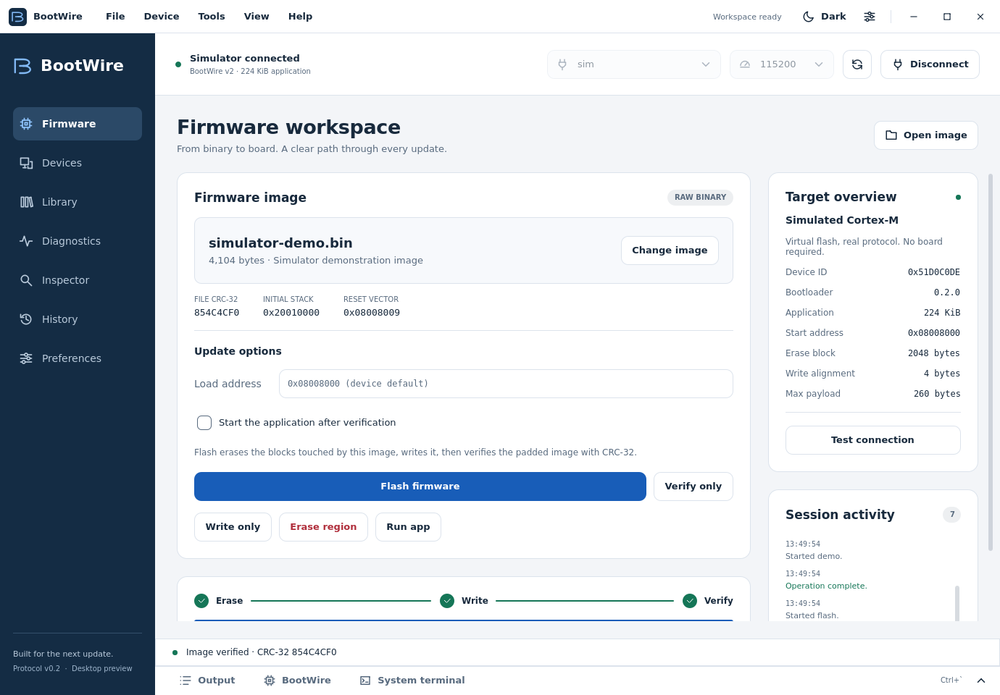
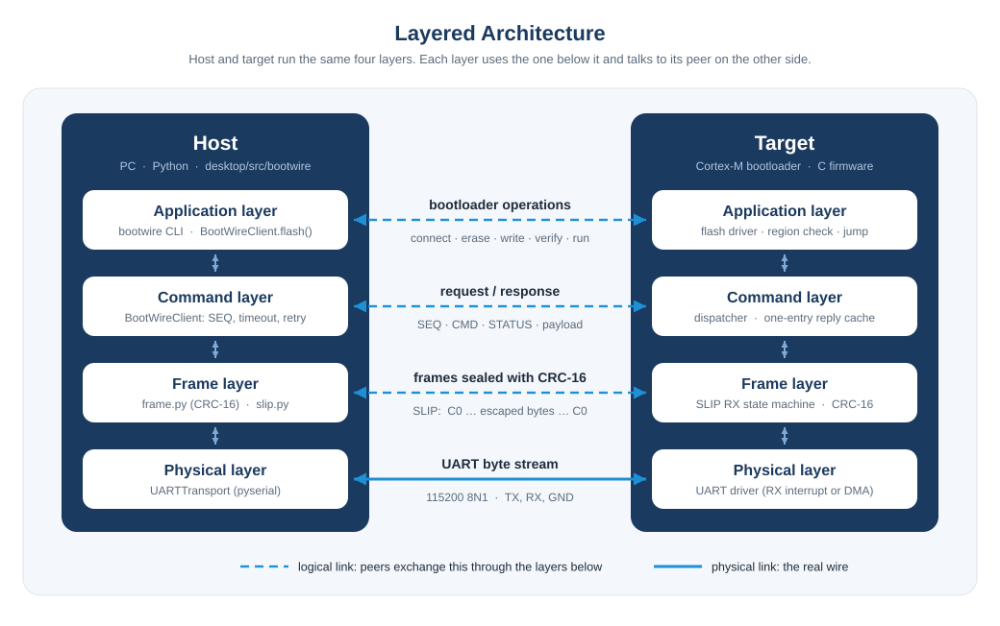
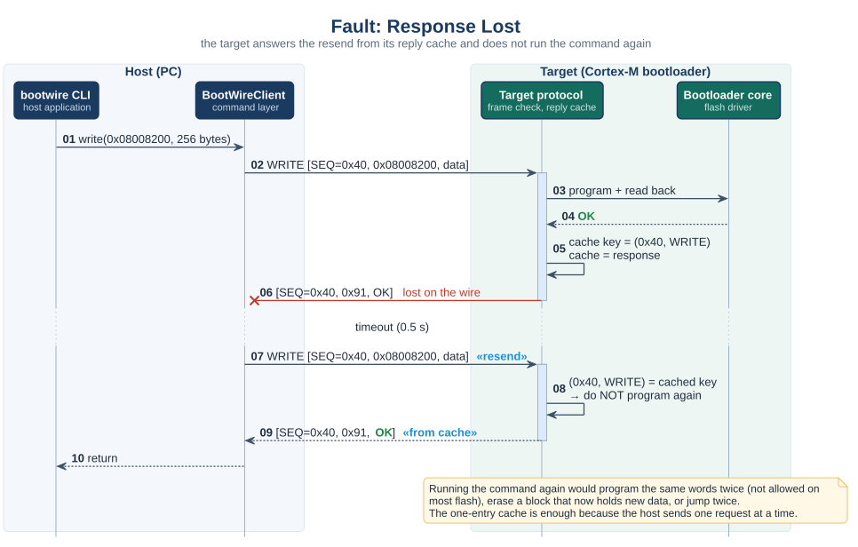
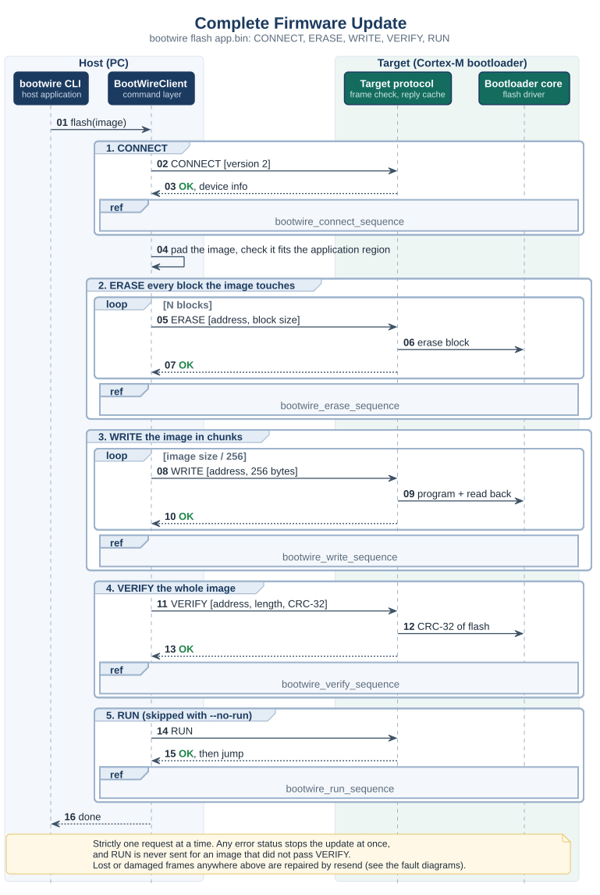
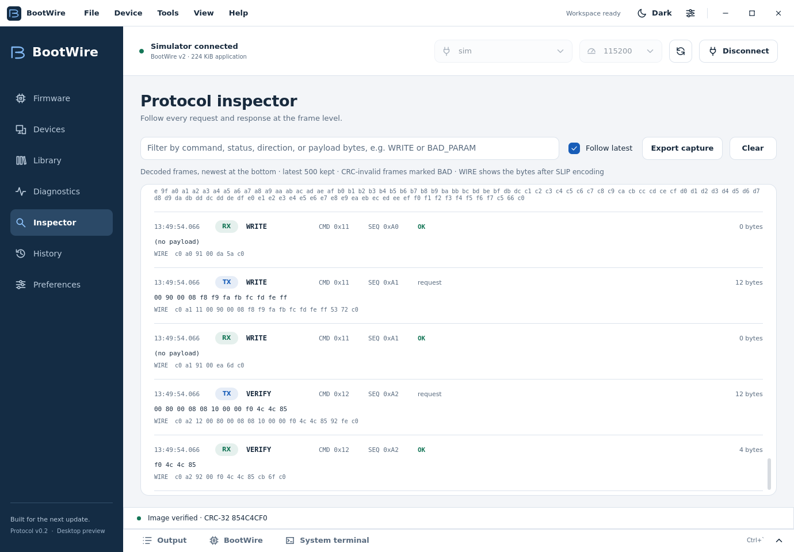

<div align="center">


# BootWire

**Reliable firmware updates for ARM Cortex-M microcontrollers over UART.**

A small, documented bootloader protocol with everything the host side needs:<br>
a Python library, a command-line tool, a desktop app and a simulated target.

[](https://github.com/orcalinux/bootwire/actions/workflows/desktop.yml)
[](https://github.com/orcalinux/bootwire/releases/latest)
[](docs/protocol/README.md)
[](desktop/pyproject.toml)
[](docs/desktop/README.md)
[](#-install)
[](LICENSE)

[**Quick start**](#-quick-start) ·
[**Protocol spec**](docs/protocol/README.md) ·
[**Desktop guide**](docs/desktop/README.md) ·
[**CLI manual**](desktop/man/bootwire.1) ·
[**Releases**](https://github.com/orcalinux/bootwire/releases)

</div>

<picture>
  <source media="(prefers-color-scheme: dark)" srcset="docs/images/firmware-dark.png">
  
</picture>

---

## ✨ Features

| | |
|---|---|
| 🔒 **Checked three times** | CRC-16 on every frame, read-back after every write, CRC-32 over the whole image before the application may start. |
| 🔁 **Survives a bad cable** | Stop-and-wait with a reply cache: lost or damaged frames are resent and never executed twice. |
| 🧭 **Nothing hard-coded** | The target reports its flash layout, erase block, alignment and payload limit; the host adapts. |
| 🛡️ **Can't brick itself** | The target refuses any address outside the application region, so the bootloader is never overwritten. |
| 🧩 **Your own commands** | IDs `0x40`–`0x7F` are yours: send any payload and read the reply. |
| 🧪 **No board needed** | A simulated target that behaves exactly like the firmware should, with fault injection. |
| 🖥️ **CLI and desktop app** | Script updates with `bootwire`, or use the desktop app with a frame inspector, batches and a built-in terminal. |
| 📦 **Packaged** | A Debian package with man pages, plus a `pip` install for everything else. |

## 🚀 Quick start

Try it without hardware. The repository's `Makefile` creates a virtual environment on first use:

```bash
git clone https://github.com/orcalinux/bootwire.git
cd bootwire

make cli ARGS="-p sim info"            # ask the simulated target what it is
make cli ARGS="-p sim flash app.bin"   # erase, write, verify, run
make gui                               # open the desktop app; choose "sim" and Connect
make help                              # every other target
```

With a board running a BootWire bootloader:

```bash
bootwire -p /dev/ttyACM0 flash build/app.bin
```

## 📥 Install

<details open>
<summary><b>Debian / Ubuntu</b> (.deb)</summary>

Download `bootwire_<version>_all.deb` from the [latest release](https://github.com/orcalinux/bootwire/releases/latest), then:

```bash
sudo apt install ./bootwire_0.2.0_all.deb
bootwire --help
man bootwire
```

The package uses your system's Python packages. The Qt packages for `bootwire-gui` are installed as recommended dependencies; add `--no-install-recommends` for the command-line tool only.

To build the package yourself: `make deb`.
</details>

<details>
<summary><b>pip</b> (Linux, Windows, macOS)</summary>

```bash
cd desktop
python3 -m venv .venv && source .venv/bin/activate
pip install -e .            # library and CLI (Python 3.9+)
pip install -e '.[gui]'     # plus the desktop app (Python 3.10+)
```
</details>

## 🧠 How it works

The full rules are in the [specification](docs/protocol/README.md). In short:



**Two frames.** The host sends a request, the target answers with a response. Both end with a CRC-16 and travel inside SLIP framing (`C0 … C0`, with `C0`/`DB` escaped).

```
Request : SEQ  CMD             PAYLOAD  CRC16
Response: SEQ  CMD|0x80 STATUS PAYLOAD  CRC16          (all fields little-endian)
```

**Stop-and-wait with a reply cache.** One request at a time. With no valid answer in time, the host resends the same frame (same SEQ). The target keeps its last response; a request with the same SEQ and CMD is answered from that cache and never executed twice. Damaged frames are dropped in silence, error statuses are final, and every session starts with CONNECT, which clears the cache.



| ID | Command | Purpose |
|---|---|---|
| `0x00` | CONNECT | start a session; the target reports versions, flash layout and limits |
| `0x01` | PING | echo bytes; check the link |
| `0x10` | ERASE | erase one or more erase blocks |
| `0x11` | WRITE | program data at an address; the target reads it back |
| `0x12` | VERIFY | compare the CRC-32 of a flash range |
| `0x13` | RUN | check the application's vector table and jump to it |
| `0x40`–`0x7F` | user | your own commands |



All 28 diagrams, grouped by architecture, frames, state machines, commands and faults, are listed in the [diagram index](docs/protocol/README.md#13-diagram-index).

## ⌨️ Command-line tool

```
bootwire [-p PORT] [-b BAUD] [-t TIMEOUT] [-r RETRIES] [-c CONFIG] [-i] COMMAND [ARGS]
```

| Command | Example | Does |
|---|---|---|
| `info` | `bootwire info` | show versions, device ID, application region, erase block, alignment, max payload |
| `ping` | `bootwire ping -n 10` | echo test with round-trip time |
| `erase` | `bootwire erase -a 0x08008000 -l 0x4000` | erase (default: the whole application region) |
| `write` | `bootwire write app.bin` | write into erased flash |
| `verify` | `bootwire verify app.bin` | compare CRC-32 of file and flash |
| `run` | `bootwire run` | start the application |
| `flash` | `bootwire flash app.bin [--no-run]` | erase, write, verify, run |
| `send` | `bootwire send 0x40 -d "01 02" --hex` | any command, prints status and payload |

- Global options come **before** the command. `-p sim` uses the built-in simulated target; without `-p`, the only serial port present is used, or you are asked to choose.
- Ports can be device names or pyserial URLs, such as `socket://192.168.1.50:4001` for a serial-to-TCP bridge.
- Settings come from `--config`, `$BOOTWIRE_CONFIG`, `./bootwire.yaml` or `~/.bootwire.yaml`; options override them.
- Exit code: `0` success, `1` the target refused or did not answer, `2` bad usage, file or port.

The complete reference is the man page: `man bootwire`, or `make man` from a checkout.

## 🖥️ Desktop app

<picture>
  <source media="(prefers-color-scheme: dark)" srcset="docs/images/inspector-dark.png">
  
</picture>

`bootwire-gui` is built on the same library as the CLI:

- **Firmware**: pick or drop a `.bin`, check its vector table, then flash, verify, write, erase or run with stage progress.
- **Devices**: saved connection profiles and sequential batch updates.
- **Library**: a local catalog of releases with version labels, CRC-32 and SHA-256.
- **Diagnostics**: ping tests, user commands and simulator fault injection.
- **Inspector**: every decoded request and response, with wire bytes.
- **History**: the last 100 jobs.
- **Developer panel** (`Ctrl+J`): verbose output, BootWire commands on the open session, and a local shell.

Light and dark themes are included. See the [desktop guide](docs/desktop/README.md) for workflows and current limits.

## 🐍 Host library

```python
from bootwire.client import BootWireClient
from bootwire.transport.uart import UARTTransport
from bootwire.errors import BootWireStatusError, BootWireTimeout

client = BootWireClient(UARTTransport("/dev/ttyACM0", 115200), timeout=0.5, max_retries=3)
try:
    info = client.connect()                      # always first
    print(hex(info.app_start), info.max_payload)

    image = open("app.bin", "rb").read()
    client.flash(image, progress=lambda stage, done, total: print(stage, done, total))

    reply = client.send(0x40, b"\x01")           # a user command
except BootWireStatusError as e:                 # the target said no: e.status, e.payload
    print(e)
except BootWireTimeout as e:                     # no valid answer after all retries
    print(e)
finally:
    client.close()
```

| Method | Does |
|---|---|
| `transact(cmd, payload, timeout=None)` / `send(...)` | one request, returns the response payload; resends on silence; raises on error status |
| `connect()` | CONNECT, checks the protocol version, stores `client.info` |
| `ping(data)` | PING, checks the echo |
| `erase(address, length)`, `write(address, data)`, `verify(address, length, crc32)`, `run()` | the single commands |
| `erase_region(address=None, length=None, progress=None)` | erase every block a range touches (default: whole application region) |
| `write_image(data, address=None, progress=None)` | pad and write in the largest chunks the target allows |
| `verify_image(data, address=None)` | CRC-32 check of the padded image |
| `flash(data, address=None, run=True, progress=None)` | connect, erase, write, verify, run |

A transport is any object with `write(bytes)`, `read(timeout) -> bytes`, `reset_input()` and `close()`. `LoopbackTransport` connects to an in-process `SimTarget` and can drop or damage frames for testing.

## 🔧 Implementing the target side

The C bootloader is the next step for this project. The firmware must behave exactly like `SimTarget` in [`desktop/src/bootwire/sim/target.py`](desktop/src/bootwire/sim/target.py); read it next to [§10 of the spec](docs/protocol/README.md#10-target-behaviour).

<details>
<summary><b>Suggested modules, order of work and Cortex-M notes</b></summary>

### Suggested modules

| File | Job | Diagram |
|---|---|---|
| `bootwire_crc.c` | CRC-16/CCITT-FALSE, CRC-32/ISO-HDLC | [request frame](docs/protocol/image/frames/bootwire_request_frame.svg) |
| `bootwire_slip.c` | RX state machine (called from the UART ISR), TX encoder | [SLIP receive](docs/protocol/image/states/bootwire_slip_rx_state.svg) |
| `bootwire_frame.c` | check a frame, build a response | [frame to wire](docs/protocol/image/frames/bootwire_wire_format.svg) |
| `bootwire_dispatch.c` | reply cache, command table, payload checks | [target frame handling](docs/protocol/image/states/bootwire_target_frame_handling.svg) |
| `bl_flash.c` | erase, program, read back, region and alignment checks | [ERASE](docs/protocol/image/sequences/bootwire_erase_sequence.svg), [WRITE](docs/protocol/image/sequences/bootwire_write_sequence.svg) |
| `bl_boot.c` | boot decision, image check, jump | [boot entry](docs/protocol/image/states/bootwire_boot_entry.svg), [RUN](docs/protocol/image/sequences/bootwire_run_sequence.svg) |
| `bl_config.h` | `APP_START`, `APP_SIZE`, `ERASE_BLOCK`, `WRITE_ALIGN`, `MAX_PAYLOAD`, RAM range | [memory map](docs/protocol/image/architecture/bootwire_memory_map.svg) |

### Order of work

1. **CRC and frames.** Unit-test against the [test vectors](docs/protocol/README.md#12-reference-values-and-test-vectors) (`01 01 1F 3E` for PING, CRC-16 check `0x29B1`, CRC-32 check `0xCBF43926`).
2. **SLIP RX and PING.** `bootwire ping -n 100` must pass; then `bootwire ping -d "C0 DB" --hex` (escapes).
3. **CONNECT** with your real layout; `bootwire info` must show it.
4. **ERASE and WRITE** with region and alignment checks and read-back. Try a write below `APP_START` with `bootwire send 0x11 -d "00 00 00 08 00 00 00 00" --hex`: it must answer BAD_PARAM.
5. **VERIFY** with CRC-32, then `bootwire flash app.bin --no-run` followed by `bootwire verify app.bin`.
6. **RUN** with the vector-table check and the jump; then the boot window and boot-request word.
7. **Faults.** Pull the cable during `bootwire flash`, plug it back, run it again: it must finish, and the image must verify.

### Cortex-M notes

- **Static memory only.** RX buffer `MAX_PAYLOAD + 4` bytes, TX buffer `2 × (MAX_PAYLOAD + 5) + 2` (worst-case SLIP), one cached response. No heap.
- **CRC hardware.** Most STM32 CRC units compute CRC-32/MPEG-2 by default. Families with input/output reversal (F0, F3, F7, G0, G4, L4, H7, U5, WB …) give CRC-32/ISO-HDLC with byte input reversal, output reversal, init `0xFFFFFFFF` and a final XOR with `0xFFFFFFFF`. F1, F2, F4 cannot: use a software CRC (a 1 KiB table or the bitwise loop).
- **Write alignment** depends on the part: 2 bytes (F1), 4 (F4, at x32), 8 (L4, G4, WB), 16 (U5), 32 (H7). Report it in CONNECT; the host adapts.
- **Erase block** must be the same size across the application region (see [Roadmap](#-roadmap)). On F2/F4/F7 with mixed sector sizes, start the region where sectors are uniform, for example `0x08020000` (128 KiB sectors) on an F4.
- **Erasing stalls the CPU** on single-bank parts when code runs from the same bank. A byte arriving then may be lost: that only damages a resend, which the host repeats. Running the flash routines from RAM avoids it.
- **The jump** (after the RUN response has left the UART):

```c
typedef void (*app_entry_t)(void);

__attribute__((noreturn)) static void bl_jump_to_app(uint32_t app_start)
{
    const uint32_t sp    = ((const volatile uint32_t *)app_start)[0];
    const uint32_t entry = ((const volatile uint32_t *)app_start)[1];

    __disable_irq();
    SysTick->CTRL = 0;
    SysTick->LOAD = 0;
    SysTick->VAL  = 0;
    /* de-initialise the UART, timers, DMA and clocks the bootloader used */

    for (uint32_t i = 0; i < sizeof(NVIC->ICER) / sizeof(NVIC->ICER[0]); i++) {
        NVIC->ICER[i] = 0xFFFFFFFFu;            /* disable every interrupt */
        NVIC->ICPR[i] = 0xFFFFFFFFu;            /* clear pending ones */
    }

    SCB->VTOR = app_start;
    __DSB();
    __ISB();
    __set_MSP(sp);
    __enable_irq();                             /* PRIMASK as after a reset */
    ((app_entry_t)entry)();
    for (;;) { }
}
```

- **Image check before the jump**: `sp` inside RAM and 4-byte aligned; `entry & 1` set; `entry & ~1` inside `[APP_START, APP_START + APP_SIZE)`.
- **The application** must be linked for `APP_START` (edit `FLASH ORIGIN` in its linker script) and should set the boot-request word and reset when it receives an "enter bootloader" request.

</details>

## 🗂️ Repository layout

```
bootwire/
├── Makefile                  make help: run, test, package
├── docs/protocol/            the specification (v0.2) and all 28 diagrams with their sources
├── docs/desktop/             desktop app guide
├── packaging/build-deb.sh    Debian package build
└── desktop/                  host side (Python)
    ├── src/bootwire/         library: protocol/, transport/, client.py, sim/
    ├── src/bootwire_cli/     the bootwire command
    ├── src/bootwire_gui/     the desktop app (PySide6 + QML)
    ├── man/                  bootwire(1), bootwire-gui(1)
    └── tests/                pytest suite, including fault injection and Qt integration
```


## 🧪 Testing

```bash
make test                     # or: cd desktop && pytest -q
```

| File | Covers |
|---|---|
| `test_crc.py` | CRC-16 check values |
| `test_slip.py` | SLIP encode/decode, stream reader: noise, split chunks, bad escapes, oversize frames |
| `test_frame.py` | frame build/parse, every flipped bit detected, **golden vectors for the firmware** |
| `test_config.py` | settings files, precedence, bad YAML |
| `test_client.py` | client against `SimTarget`: full update, region and alignment errors, read-back and CRC-32 mismatches, lost/damaged requests and responses, late responses, retry limit, reply cache and CONNECT, user commands |
| `gui/test_session.py` | Qt-independent desktop workflows: image identity, cancellation, validation, commands, simulator recovery |
| `gui/test_controller.py` | Qt integration: real QML rendering and controls, profiles, batches, phases, themes, exports, history |

CI runs the suite on Ubuntu and Windows for every push and pull request.

## 🛣️ Roadmap

- [ ] **Target bootloader in C** for Cortex-M, following the guide above.
- [ ] **Signed images** (for example ECDSA P-256), checked on the target before RUN. Today anyone with the UART can flash any image.
- [ ] **Rollback**: an image trailer with size and CRC-32 checked at every boot, and an A/B slot layout on larger parts.
- [ ] **Mixed sector sizes**: a region table in CONNECT instead of one erase-block size.
- [ ] **More links**: USB CDC or CAN under the same command layer.
- [ ] **Speed**: stop-and-wait costs one round trip per 256 bytes. Raise `max_payload` or the baud rate before adding pipelining.

<details>
<summary><b>What changed from v0.1, and why</b></summary>

v0.1 copied the STBee CRA protocol (command, response, acknowledge) and added bootloader commands. Reading the spec and running the host code showed that a large part of the design was not needed for a bootloader, and that the code did not work. v0.2 keeps what earns its place and removes the rest.

**Removed**

| v0.1 had | Why it went |
|---|---|
| ACK frame, target ACK timer, response retransmit by the target | With stop-and-wait, the host's resend plus the target's reply cache already recover a lost response. The third message only added a timer, a state and more traffic on both sides. |
| 256 concurrent sessions, 2 priority bits | A bootloader runs commands strictly in order. Pipelining also makes flash operations race each other. |
| Payload Len / Resp Len fields | The SLIP END byte ends the frame and the CRC proves it is whole. |
| CRC EN bit and the DTL header byte | A bootloader must never accept an unchecked frame, so the CRC is always on and needs no flag. |
| "Fragmentation" layer | Never defined in any frame format. Each WRITE now carries its own address instead. |
| VERIFY_CHUNK and ABORT | Replaced by read-back on WRITE and one CRC-32 VERIFY over the image. |
| RTS/CTS or XON/XOFF | Not needed with one small frame in flight; XON/XOFF would corrupt binary data. |

**Added**: CONNECT with the flash layout, PING, addressed WRITE with read-back, VERIFY with CRC-32, RUN with a vector-table check, descriptive status codes, region protection, timing and retry rules, test vectors, and documented target behaviour.

**Fixed in the host code**: the receiver returned the leading `C0` alone, so no response ever decoded; responses were parsed with the wrong header length; no CRC was sent or checked; error statuses were retried like timeouts; writes had no address and exceeded the frame limit; the `general` config section was ignored; and no complete update was possible from the CLI.

</details>

## 🤝 Contributing

Issues and pull requests are welcome. Before opening a pull request:

1. Run `make test`.
2. If you change the protocol, change the [spec](docs/protocol/README.md), `client.py` and `sim/target.py` together, and regenerate the diagrams with `make diagrams`.
3. If you change a CLI option or command, update the man page in `desktop/man/bootwire.1`.

## 📄 License

[MIT](LICENSE) © Mahmoud Abdelraouf
