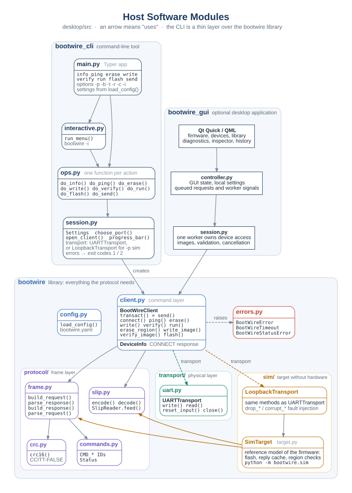

# BootWire

**BootWire** is a small, robust protocol for updating the firmware of a 32-bit
ARM Cortex-M microcontroller over UART, and for sending your own commands to it. This repository
holds the protocol specification, every design diagram, and the complete host side: a Python
library, the `bootwire` command-line tool, a simulated target and the tests.

| Part | State |
|---|---|
| Protocol specification v0.2 | [`docs/protocol/README.md`](docs/protocol/README.md) |
| Diagrams (28, all sources included) | [`docs/protocol/image/`](docs/protocol/image), regenerated by [`docs/protocol/render.sh`](docs/protocol/render.sh) |
| Host library and CLI (Python) | done, in [`desktop/`](desktop) |
| Desktop GUI (PySide6 + Qt Quick) | working preview; [features and guide](docs/desktop/README.md) |
| Simulated target (reference for the firmware) | done, [`desktop/src/bootwire/sim/target.py`](desktop/src/bootwire/sim/target.py) |
| Target bootloader (C, Cortex-M) | next step, guide in [§7](#7-implementing-the-target-side) |

## Contents

1. [Quick start](#1-quick-start)
2. [How BootWire works](#2-how-bootwire-works)
3. [Design review: what changed from v0.1 and why](#3-design-review-what-changed-from-v01-and-why)
4. [Repository layout](#4-repository-layout)
5. [Host library](#5-host-library)
6. [Command-line tool](#6-command-line-tool)
7. [Implementing the target side](#7-implementing-the-target-side)
8. [Testing](#8-testing)
9. [Limits and roadmap](#9-limits-and-roadmap)

---

## 1 Quick start

```bash
cd desktop
python3 -m venv .venv && source .venv/bin/activate
pip install -e '.[dev]'

pytest -q                      # core + desktop workflows, including fault injection

bootwire -p sim info                # talk to the built-in simulated target
bootwire -p sim flash app.bin       # erase, write, verify, run (simulated)
```

Against the simulator on a real (pseudo) serial port, the way a board is used:

```bash
python -m bootwire.sim         # prints e.g. "BootWire simulated target on /dev/pts/5"
bootwire -p /dev/pts/5 info         # in another terminal
bootwire -p /dev/pts/5 flash app.bin
```

With a board running a BootWire bootloader:

```bash
bootwire -p /dev/ttyACM0 flash build/app.bin
```

### Desktop application

```bash
cd desktop
source .venv/bin/activate
pip install -e '.[gui]'
bootwire-gui
```

The optional GUI requires Python 3.10+. It includes firmware flashing, device profiles and sequential batch updates, a versioned local firmware library, diagnostics, a frame inspector, job history, a developer output/command panel, a local Linux/Windows shell terminal, and light/dark themes. Choose `sim`, connect, then try a demo image to explore without a board. See the [desktop application guide](docs/desktop/README.md) for workflow details and current limitations.

## 2 How BootWire works

The full rules are in the [specification](docs/protocol/README.md). In short:


**Two frames.** The host sends a request, the target answers with a response. Both end with a
CRC-16 and travel inside SLIP framing (`C0 … C0`, with `C0`/`DB` escaped).

```
Request : SEQ  CMD             PAYLOAD  CRC16
Response: SEQ  CMD|0x80 STATUS PAYLOAD  CRC16          (all fields little-endian)
```


**Stop-and-wait with a reply cache.** One request at a time. With no valid answer in time, the host
resends the same frame (same SEQ). The target keeps its last response; a request with the same SEQ
and CMD is answered from that cache and never executed twice. Damaged frames are dropped in silence,
error statuses are final, and every session starts with CONNECT, which clears the cache.


**Commands.**

| ID | Command | Purpose |
|---|---|---|
| `0x00` | CONNECT | start a session; the target reports versions, flash layout and limits |
| `0x01` | PING | echo bytes; check the link |
| `0x10` | ERASE | erase one or more erase blocks |
| `0x11` | WRITE | program data at an address; the target reads it back |
| `0x12` | VERIFY | compare the CRC-32 of a flash range |
| `0x13` | RUN | check the application's vector table and jump to it |
| `0x40`–`0x7F` | user | your own commands |

**Correct data, checked three times:** CRC-16 on every frame, read-back after every WRITE, and a
CRC-32 of the whole image before RUN is allowed.


All diagrams, grouped by architecture, frames, state machines, commands and faults, are listed in the
[diagram index](docs/protocol/README.md#13-diagram-index).

## 3 Design review: what changed from v0.1 and why

v0.1 copied the STBee CRA protocol (command, response, acknowledge) and added bootloader commands.
Reading the spec and running the host code showed that a large part of the design was not needed
for a bootloader, and that the code did not work. v0.2 keeps what earns its place and removes the rest.

### 3.1 Removed from the design

| v0.1 had | Why it went |
|---|---|
| ACK frame, target ACK timer, response retransmit by the target | With stop-and-wait, the host's resend plus the target's reply cache already recover a lost response. The third message only added a timer, a state and more traffic on both sides. |
| 256 concurrent sessions, 2 priority bits | A bootloader runs commands strictly in order. Pipelining also makes flash operations race each other. |
| Payload Len / Resp Len fields | The SLIP END byte ends the frame and the CRC proves it is whole. The length field was redundant and the spec disagreed on whether the ACK had it (3 or 5 bytes). |
| CRC EN bit and the DTL header byte | A bootloader must never accept an unchecked frame, so the CRC is always on and needs no flag. |
| "Fragmentation" layer, `Seq#` in diagrams | Never defined in any frame format. Each WRITE now carries its own address instead. |
| VERIFY_CHUNK and ABORT | VERIFY_CHUNK repeated the frame CRC; with addressed writes the target holds no transfer state to verify or abort. Replaced by read-back on WRITE and one CRC-32 VERIFY over the image. |
| RTS/CTS or XON/XOFF | Not needed with one small frame in flight; XON/XOFF would corrupt binary data. |
| `transport/tcp.py`, `protocol/ports.py`, `events.py`, the mixin class tree, `argcomplete`, `prompt_toolkit` | Unused or replaced: pyserial URLs (`socket://host:port`) already give TCP, Typer has completion built in. |
| The old SVG frame pictures and 12 sequence diagrams | They showed the ACK flow and could not be edited (text was outlined). All 28 diagrams are now generated from source, on a white background. |

### 3.2 Added

- **CONNECT**: version check and the flash layout reported by the target, so the host hard-codes nothing.
- **PING**: link test.
- **Addressed WRITE with read-back**, **VERIFY with CRC-32**, **RUN with a vector-table check**.
- **Status codes** that say what went wrong (BAD_PARAM, FLASH, VERIFY, NO_APP …).
- **Region protection**: the target refuses any address outside the application region, so the
  bootloader can never erase or overwrite itself.
- **Timing and retry rules** with defaults, and **test vectors** for the firmware.
- **Target behaviour**: boot entry, RX state machine, frame handling and the jump, each with a diagram.

### 3.3 Bugs found in the v0.1 host code

Each was checked by running the old code; all are fixed by the rewrite.

| Bug | Effect |
|---|---|
| `UARTTransport.recv_frame()` used `read_until(0xC0)`, which returns the **leading** `C0` alone | every response failed to decode: the tool could never talk to a target |
| `parse_frame()` read a 5-byte header with a length field from responses, while the spec defined a 4-byte response header | a valid response failed with "length mismatch"; a response with status `0x04` was taken for an ACK |
| the client never used `dtl.py`, so no CRC was sent or checked | CRC existed only on paper |
| the client never sent ACKs | the target of the v0.1 spec would retransmit every response forever |
| error statuses were retried like timeouts | a rejected command was sent 5 times |
| `WRITE_CHUNK` had no address and the CLI sent 256-byte chunks while the spec limited frames to 64 bytes | the target could not know where data belonged, and could not receive it |
| `load_config()` ignored the `general` section | `max_retries` in `bootwire.yaml` had no effect |
| only `erase`, `write` and `message` existed in the CLI; `verify`, `reset`, `abort` were missing | no complete update was possible |

## 4 Repository layout

```
bootwire/
├── README.md                     this file
├── docs/protocol/
│   ├── README.md                 the specification (v0.2)
│   ├── render.sh                 regenerate every SVG from the sources
│   ├── py/                       bootwire_figures.py (layers, frames, memory map), svg_post.py
│   ├── puml/                     PlantUML sources: architecture/, states/, sequences/
│   ├── dot/                      Graphviz sources: architecture/, states/
│   └── image/                    generated SVGs: architecture/, frames/, states/, sequences/
└── desktop/                      host side (Python ≥ 3.9)
    ├── pyproject.toml            package bootwire, entry point `bootwire`
    ├── bootwire.yaml                  example settings
    ├── src/bootwire/             library
    │   ├── protocol/             crc.py, slip.py, frame.py, commands.py
    │   ├── transport/uart.py     serial port (any pyserial URL)
    │   ├── client.py             BootWireClient, DeviceInfo
    │   ├── errors.py             BootWireError, BootWireTimeout, BootWireStatusError
    │   ├── config.py             load_config()
    │   └── sim/                  SimTarget, LoopbackTransport, `python -m bootwire.sim`
    ├── src/bootwire_cli/              command-line tool
    │   ├── main.py               Typer app and commands
    │   ├── ops.py                one function per action
    │   ├── session.py            settings, port choice, error → exit code, progress bars
    │   └── interactive.py        `bootwire -i` menu
    ├── src/bootwire_gui/         optional PySide6 + QML desktop app
    └── tests/                    core + desktop workflow and Qt integration tests
```



## 5 Host library

```python
from bootwire.client import BootWireClient
from bootwire.transport.uart import UARTTransport
from bootwire.errors import BootWireStatusError, BootWireTimeout

client = BootWireClient(UARTTransport("/dev/ttyACM0", 115200), timeout=0.5, max_retries=3)
try:
    info = client.connect()                      # always first
    print(hex(info.app_start), info.max_payload)

    image = open("app.bin", "rb").read()
    client.flash(image, progress=lambda stage, done, total: print(stage, done, total))

    reply = client.send(0x40, b"\x01")           # a user command
except BootWireStatusError as e:                      # the target said no: e.status, e.payload
    print(e)
except BootWireTimeout as e:                          # no valid answer after all retries
    print(e)
finally:
    client.close()
```

| Method | Does |
|---|---|
| `transact(cmd, payload, timeout=None)` / `send(...)` | one request, returns the response payload; resends on silence; raises on error status |
| `connect()` | CONNECT, checks the protocol version, stores `client.info` |
| `ping(data)` | PING, checks the echo |
| `erase(address, length)`, `write(address, data)`, `verify(address, length, crc32)`, `run()` | the single commands |
| `erase_region(address=None, length=None, progress=None)` | erase every block a range touches (default: whole application region) |
| `write_image(data, address=None, progress=None)` | pad and write in the largest chunks the target allows |
| `verify_image(data, address=None)` | CRC-32 check of the padded image |
| `flash(data, address=None, run=True, progress=None)` | connect, erase, write, verify, run |

A transport is any object with `write(bytes)`, `read(timeout) -> bytes`, `reset_input()` and
`close()`. `UARTTransport` accepts device names and pyserial URLs (`socket://192.168.1.50:4001` for a
serial-to-TCP bridge). `LoopbackTransport` connects to an in-process `SimTarget` and can drop or
damage frames for testing.

## 6 Command-line tool

```
bootwire [-p PORT] [-b BAUD] [-t TIMEOUT] [-r RETRIES] [-c CONFIG] [-i] COMMAND [ARGS]
```

| Command | Example | Does |
|---|---|---|
| `info` | `bootwire info` | show versions, device ID, application region, erase block, alignment, max payload |
| `ping` | `bootwire ping -n 10` | echo test with round-trip time |
| `erase` | `bootwire erase -a 0x08008000 -l 0x4000` | erase (default: the whole application region) |
| `write` | `bootwire write app.bin` | write into erased flash |
| `verify` | `bootwire verify app.bin` | compare CRC-32 of file and flash |
| `run` | `bootwire run` | start the application |
| `flash` | `bootwire flash app.bin [--no-run]` | erase, write, verify, run |
| `send` | `bootwire send 0x40 -d "01 02" --hex` | any command, prints status and payload |

- `-p sim` uses the built-in simulated target. Without `-p`, the only serial port present is used,
  or you are asked to choose.
- Addresses accept decimal or `0x` hex. Image files are raw binaries (`.bin`), linked for `app_start`.
- Settings come from `--config`, `$BOOTWIRE_CONFIG`, `./bootwire.yaml` or `~/.bootwire.yaml`; options override them.
- Exit code: `0` success, `1` the target refused or did not answer, `2` bad usage, file or port.

More in [`desktop/README.md`](desktop/README.md).

## 7 Implementing the target side

The firmware must behave exactly like `SimTarget` in
[`desktop/src/bootwire/sim/target.py`](desktop/src/bootwire/sim/target.py). Read it next to
[§10 of the spec](docs/protocol/README.md#10-target-behaviour).

### 7.1 Suggested modules

| File | Job | Diagram |
|---|---|---|
| `bootwire_crc.c` | CRC-16/CCITT-FALSE, CRC-32/ISO-HDLC | [request frame](docs/protocol/image/frames/bootwire_request_frame.svg) |
| `bootwire_slip.c` | RX state machine (called from the UART ISR), TX encoder | [SLIP receive](docs/protocol/image/states/bootwire_slip_rx_state.svg) |
| `bootwire_frame.c` | check a frame, build a response | [frame to wire](docs/protocol/image/frames/bootwire_wire_format.svg) |
| `bootwire_dispatch.c` | reply cache, command table, payload checks | [target frame handling](docs/protocol/image/states/bootwire_target_frame_handling.svg) |
| `bl_flash.c` | erase, program, read back, region and alignment checks | [ERASE](docs/protocol/image/sequences/bootwire_erase_sequence.svg), [WRITE](docs/protocol/image/sequences/bootwire_write_sequence.svg) |
| `bl_boot.c` | boot decision, image check, jump | [boot entry](docs/protocol/image/states/bootwire_boot_entry.svg), [RUN](docs/protocol/image/sequences/bootwire_run_sequence.svg) |
| `bl_config.h` | `APP_START`, `APP_SIZE`, `ERASE_BLOCK`, `WRITE_ALIGN`, `MAX_PAYLOAD`, RAM range | [memory map](docs/protocol/image/architecture/bootwire_memory_map.svg) |

### 7.2 Order of work

1. **CRC and frames.** Unit-test against the [test vectors](docs/protocol/README.md#12-reference-values-and-test-vectors)
   (`01 01 1F 3E` for PING, CRC-16 check `0x29B1`, CRC-32 check `0xCBF43926`).
2. **SLIP RX and PING.** `bootwire ping -n 100` must pass; then `bootwire ping -d "C0 DB" --hex` (escapes).
3. **CONNECT** with your real layout; `bootwire info` must show it.
4. **ERASE and WRITE** with region and alignment checks and read-back. Try a write below `APP_START`
   with `bootwire send 0x11 -d "00 00 00 08 00 00 00 00" --hex`: it must answer BAD_PARAM.
5. **VERIFY** with CRC-32, then `bootwire flash app.bin --no-run` followed by `bootwire verify app.bin`.
6. **RUN** with the vector-table check and the jump; then the boot window and boot-request word.
7. **Faults.** Pull the cable during `bootwire flash`, plug it back, run it again: it must finish, and the
   image must verify.

### 7.3 Cortex-M notes

- **Static memory only.** RX buffer `MAX_PAYLOAD + 4` bytes, TX buffer `2 × (MAX_PAYLOAD + 5) + 2`
  (worst-case SLIP), one cached response. No heap.
- **CRC hardware.** Most STM32 CRC units compute CRC-32/MPEG-2 by default. Families with input/output
  reversal (F0, F3, F7, G0, G4, L4, H7, U5, WB …) give CRC-32/ISO-HDLC with byte input reversal,
  output reversal, init `0xFFFFFFFF` and a final XOR with `0xFFFFFFFF`. F1, F2, F4 cannot: use a
  software CRC (a 1 KiB table or the bitwise loop).
- **Write alignment** depends on the part: 2 bytes (F1), 4 (F4, at x32), 8 (L4, G4, WB), 16 (U5),
  32 (H7). Report it in CONNECT; the host adapts.
- **Erase block** must be the same size across the application region (see [§9](#9-limits-and-roadmap)).
  On F2/F4/F7 with mixed sector sizes, start the region where sectors are uniform, for example
  `0x08020000` (128 KiB sectors) on an F4.
- **Erasing stalls the CPU** on single-bank parts when code runs from the same bank. A byte arriving
  then may be lost: that only damages a resend, which the host repeats. Running the flash routines
  from RAM avoids it.
- **The jump** (after the RUN response has left the UART):

```c
typedef void (*app_entry_t)(void);

__attribute__((noreturn)) static void bl_jump_to_app(uint32_t app_start)
{
    const uint32_t sp    = ((const volatile uint32_t *)app_start)[0];
    const uint32_t entry = ((const volatile uint32_t *)app_start)[1];

    __disable_irq();
    SysTick->CTRL = 0;
    SysTick->LOAD = 0;
    SysTick->VAL  = 0;
    /* de-initialise the UART, timers, DMA and clocks the bootloader used */

    for (uint32_t i = 0; i < sizeof(NVIC->ICER) / sizeof(NVIC->ICER[0]); i++) {
        NVIC->ICER[i] = 0xFFFFFFFFu;            /* disable every interrupt */
        NVIC->ICPR[i] = 0xFFFFFFFFu;            /* clear pending ones */
    }

    SCB->VTOR = app_start;
    __DSB();
    __ISB();
    __set_MSP(sp);
    __enable_irq();                             /* PRIMASK as after a reset */
    ((app_entry_t)entry)();
    for (;;) { }
}
```

- **Image check before the jump**: `sp` inside RAM and 4-byte aligned; `entry & 1` set; `entry & ~1`
  inside `[APP_START, APP_START + APP_SIZE)`.
- **The application** must be linked for `APP_START` (edit `FLASH ORIGIN` in its linker script) and
  should set the boot-request word and reset when it receives an "enter bootloader" request.

## 8 Testing

```bash
cd desktop && pytest -q
```

| File | Covers |
|---|---|
| `test_crc.py` | CRC-16 check values |
| `test_slip.py` | SLIP encode/decode, stream reader: noise, split chunks, bad escapes, oversize frames |
| `test_frame.py` | frame build/parse, every flipped bit detected, **golden vectors for the firmware** |
| `test_config.py` | settings files, precedence, bad YAML |
| `test_client.py` | client against `SimTarget`: full update, region and alignment errors, read-back and CRC-32 mismatches, lost/damaged requests and responses, late responses, retry limit, reply cache and CONNECT, user commands |
| `gui/test_session.py` | Qt-independent desktop workflows: image identity, cancellation, validation, commands, simulator recovery |
| `gui/test_controller.py` | optional Qt integration: real QML rendering and controls, profiles, batches, phases, themes, exports, history |

The same suite can later run against real hardware by giving `BootWireClient` a `UARTTransport`.

## 9 Limits and roadmap

- **Uniform erase blocks.** v0.2 reports one erase-block size. A region table in CONNECT would
  support mixed sector sizes without wasting flash.
- **No authentication.** Anyone with the UART can flash any image. Next: sign images (for example
  ECDSA P-256) and check the signature on the target before RUN; optionally encrypt them.
- **No rollback.** A failed update leaves no application until the next successful one (the
  bootloader itself is never touched, so it can always retry). Next: an image trailer with size and
  CRC-32 checked at every boot, and an A/B slot layout on larger parts.
- **One link.** UART only; the frame layer is independent of it, so USB CDC or CAN can be added
  under the same command layer.
- **Speed.** Stop-and-wait costs one round trip per 256 bytes. If needed, raise `max_payload` or the
  baud rate before adding pipelining.

## License

MIT © Mahmoud Abdelraouf
