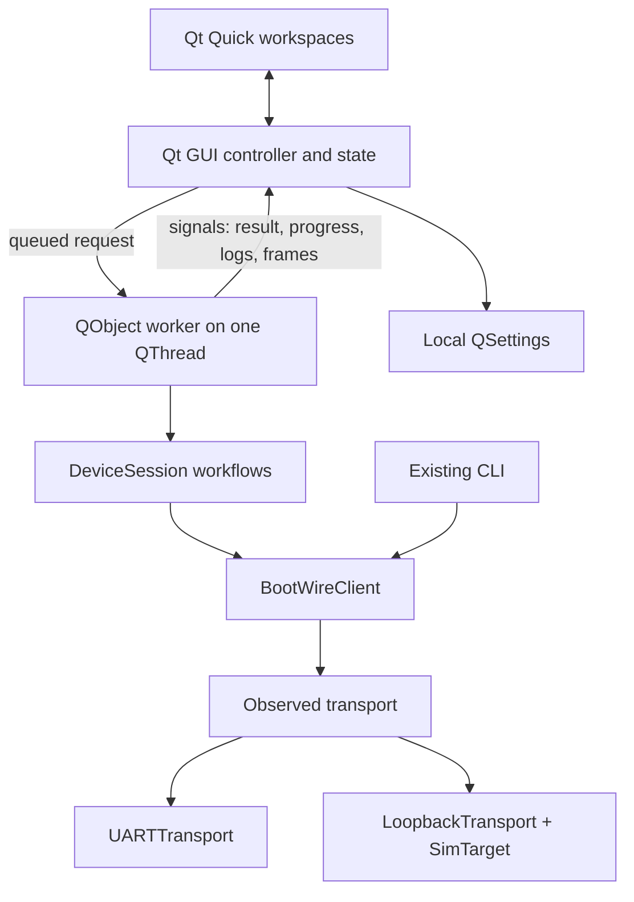

# BootWire Desktop

BootWire Desktop is an optional PySide6 + Qt Quick/QML application built on the same protocol library as the CLI. It provides a firmware workspace, saved device profiles, sequential batch updates, a local release catalog, diagnostics, frame inspection, and job history.

This is a desktop preview validated against the simulator on Linux. Real-board testing, Windows/macOS distribution, and packaged installers are still outstanding. The target C bootloader is not yet part of this repository.

## Install and launch

The GUI requires Python 3.10 or newer; the headless library and CLI retain Python 3.9 support.

```bash
cd desktop
python3 -m venv .venv
source .venv/bin/activate
pip install -e '.[gui,dev]'
bootwire-gui
# Equivalent:
python -m bootwire_gui
```

The `gui` extra is optional. Installing the CLI does not require Qt. A desktop graphical session is needed for normal use. Native Qt platform dependencies vary by OS; if Qt reports a missing platform plugin dependency, install the dependency named in that diagnostic.

## Explore without a board

1. Leave the port set to `sim` and choose **Connect**.
2. In **Firmware**, choose **Try a demo image**. It contains a vector table suitable for the virtual target and is explicitly restricted to simulation by the GUI.
3. Choose **Flash firmware** and accept the confirmation. Leave **Start the application after verification** off to keep using the target.
4. Open **Inspector** to see CONNECT, ERASE, WRITE, and VERIFY requests/responses.
5. Open **Diagnostics**, choose **Drop response**, then run a ping. The activity log records the retry, while the target serves its cached reply.
6. **Run app** exits the simulated bootloader. In Diagnostics, choose **Reset simulator**, then reconnect to start again.

The simulator persists across disconnects during one app session. Resetting it creates erased flash. Demo binaries are temporary local files; add your own stable files for a durable release library.

## Application menus and controls

The app icon, File/Device/Tools/View/Help menus, and window controls share a single title bar. Click a menu, then move across the neighboring menu labels to switch without clicking again; Left/Right and Escape provide keyboard navigation. Drag the empty title-bar area to move the window, double-click it to maximize/restore, and drag the edges or corners to resize. Minimize, maximize/restore, and close controls are at the right. Closing during a device operation retains the existing stop-and-wait guard. The menus are available from every workspace. They provide firmware opening, exports, connection and refresh, link testing, navigation, preferences, appearance, quick start, and About. Ctrl+Q closes the window (the active-operation guard still applies); Ctrl+, opens Preferences. Ctrl+1 to Ctrl+6 switch between Firmware, Devices, Library, Diagnostics, Inspector, and History.

Window snapping uses your desktop’s configured shortcuts and edge-tiling behavior. BootWire does not bind a particular snap key combination. Its minimum size is 640×540, allowing half-screen tiling on common desktop displays. Below 1000px width, navigation becomes an icon rail with hover labels and firmware panels stack vertically. The operating system controls available snap zones; zones smaller than the minimum window size cannot be used.

Dropdowns, checkboxes, numeric inputs, progress, menus, and confirmation buttons use shared BootWire styling in both themes. Port and baud dropdowns retain editable values and keyboard navigation. The original logo is packaged as SVG, PNG, and multi-size ICO and assigned to the application and main window. Window-title and taskbar icon placement depends on the desktop environment. Restart the app after upgrading to load the new icon.

A Linux `bootwire.desktop` template is included in `bootwire_gui/assets`; launcher installation is separate from pip installation. `scripts/render_icons.py` regenerates PNG/ICO assets from the preserved vector mark.

## Workspaces

| Workspace | Features |
|---|---|
| Firmware | File picker and drop, size, CRC-32, SHA-256 via catalog, vector words, optional load address, full flash, verify only, write with verification, region erase, RUN, optional automatic RUN, stage progress, cancellation, target overview, activity export |
| Devices | Named connection profiles, connect/remove/update profiles, select targets, sequential batch flash, per-target success/failure, profile export |
| Library | Version labels, notes, filename/version/notes search, image size, file CRC-32 and SHA-256, source paths, checksum validation when loading and again before flashing, catalog export |
| Diagnostics | UTF-8/hex echo tests, 1–100 pings, individual and average round-trip times, user commands 0x40–0x7F, response hex/text, simulator fault injection and reset |
| Inspector | Decoded TX/RX frames with command name and ID, sequence number in hex (as in the protocol spec), status name (`OK` green, errors red), payload length and bytes, wire-format hex, invalid-frame indications, filtering by name/status/bytes, follow-latest, clearing, JSON export |
| History | Last 100 jobs, result, timestamp, target, image, duration, search, clearing, JSON export |
| Preferences | Response/erase timeouts, retry count, connection defaults, persistent light/dark theme, keyboard shortcut reference |

Serial ports and pyserial URLs are supported. The top connection control accepts an editable port, including `socket://host:port`. Baud choices range from 9600 to 921600. Profiles save the selected baud, timeout, erase timeout, and retry count.

### Flash semantics

The GUI validates the target-reported layout before using it. It checks the image checksum, application range, and write alignment before the first erase. Flash erases every block the image touches, writes in target-sized chunks, then verifies the padded image with CRC-32. Write-only also verifies afterward. File CRC-32 shown in the image details is for the original bytes; verification CRC-32 includes any `0xFF` alignment padding.

An erase with an empty load address removes the whole application region. A custom load address erases from that address to the region end, rounded to erase blocks. Flash and erase require a reviewable confirmation in the interface. User-command console IDs are limited to 0x40–0x7F; reserved bootloader operations use the dedicated controls.

Stop is cooperative: it takes effect between commands, not during a flash-controller operation. A timeout can take the configured retries to resolve. The current image may be incomplete after stopping or a failed update; flash and verify it again before running. The window prevents closing while an operation is active and explains how to stop it first.

RUN closes the session because the application takes over the UART. A lost RUN response is reported as unconfirmed rather than asserted successful. Re-enter bootloader mode on real hardware before reconnecting.

### Batches and releases

Batches use **one active connection at a time**. The previous connection closes before the first target. Each target gets its own CONNECT and target-reported layout; errors are recorded and remaining targets continue. Stop ends the batch between commands. Two profiles referring to the same port address the same device; two `sim` profiles refer to the same virtual target. This is sequential deployment, not simultaneous device communication.

The release catalog stores references, version labels, and checksums, not copies of binaries. Moving, deleting, or changing a referenced image requires choosing and registering its new file. SHA-256 provides file identity, not publisher authentication. There is no remote release server, signing pipeline, or device fleet service in this release.

## Architecture



- `desktop/src/bootwire_gui/session.py`: Qt-independent image and device operations, validation, cooperative cancellation, simulator lifetime.
- `controller.py`: worker and GUI-thread state; request serialization; trace observation; bounded logs/history; persistent profiles/releases/preferences; JSON export. Frame, log, and progress updates change the state at once but notify the UI at most once every 40 ms, so a large flash is not slowed down by redrawing. Inspector frames live in a Qt list model (`TraceModel`) and the developer output is appended row by row, so both lists keep their scroll position while data arrives when Follow is off.
- `qml/`: native Qt Quick controls, shared theme tokens, reusable buttons/fields/panels, and seven workspaces.
- `main.py`: optional dependency guard and application lifecycle.

Device access and image hashing run in the worker. The GUI owns visible state and local settings. No QML code touches a serial port. The client, CLI, and simulator retain their Qt-free APIs. There are no concurrent requests on a client.

The frame inspector observes serial reads and decodes responses; wire hex for RX is reconstructed with canonical SLIP framing after decoding. It is a protocol inspector, not an exact timestamped electrical UART capture. Bad CRC/response frames that reach the stream decoder are marked BAD; malformed SLIP and startup noise may be discarded by framing. The latest 500 activity records and 500 frame records are kept in memory. Export before clearing or closing if you want to retain captures.

Settings, release references, profiles, theme, and the last 100 jobs are stored through `QSettings("BootWire", "Desktop")`, using the native OS settings location. There are no uploads. CLI YAML supplies initial defaults; saved GUI preferences then take precedence. Saving GUI preferences does not modify CLI YAML.

## Develop and verify

```bash
cd desktop
pytest -q
```

GUI session workflow tests run without Qt. Qt integration tests are skipped if PySide6 is absent; when present they use offscreen software rendering and temporary settings. They cover actual QML loading at 1380×900, 1000×720, and tiled widths from 640px, real Connect/Flash button clicks, destructive-action confirmation, theme switching, frame capture, history persistence, checksum changes, cancellation, simulator restrictions, error recovery, and partial batch failure.

Capture all seven populated workspaces in both themes:

```bash
cd desktop
QT_QPA_PLATFORM=offscreen QT_QUICK_BACKEND=software \
  .venv/bin/python ../scripts/preview_gui.py
```

Captures are written to `.impeccable/review/`, including open dropdowns and menus in both themes. They use an isolated settings file and the simulator, so previewing does not overwrite normal desktop preferences.

## Current boundaries

- Single active target session; sequential batches.
- Local release references, not a hosted release service or copied artifact store.
- Protocol v0.2 supports uniform erase blocks, raw `.bin` images, and UART transports. It does not provide flash readback commands, authenticated images, rollback, or A/B updates.
- Session settings and GUI behavior have been exercised on Linux in offscreen Qt. Real-device connection/disconnection behavior, physical flashing, and platform-specific file-dialog/accessibility behavior need hardware and OS testing.
- Packaging resources are included in the Python distribution. OS installers, signing, automatic updates, and deployment automation remain future work.

## Developer panel: output, commands, and local terminal

The developer panel sits flush with the bottom of the workspace; the compact device status strip stays above it. Open the panel with **Ctrl+J**, **Ctrl+`**, a bottom tab, or **View → Toggle developer panel**. Drag the top edge to resize it. Hiding the panel keeps its shell running; **Stop** ends that shell. Closing BootWire also stops the shell.

### Output

Output shows timestamped device lifecycle events, progress, retries, errors, and decoded protocol exchanges. Enable **Verbose** to include sequence numbers, command/status names, payload bytes, and wire hex. Filter by text, pause automatic following, clear, select/copy individual messages, or export JSON. The last 2,000 records are retained in memory; messages over 12,000 characters are explicitly marked truncated. This is BootWire application/protocol instrumentation, not a capture of every operating-system event.

### BootWire commands

The BootWire tab is a command interface to the **existing GUI device session**. It does not launch another CLI process or compete for the serial port. The `bootwire` prefix is optional. Up/Down recall the last 100 commands in this app session.

```text
help
bootwire -p sim info
ping -n 5 -d "C0 DB" --hex
send 0x40 -d "01 02" --hex
flash "my firmware.bin" --no-run
verify "my firmware.bin"
erase -a 0x08008000 -l 0x800
run
```

Windows file paths are preserved, including quoted paths such as `flash "C:\Firmware builds\app.bin" --no-run`. Connection options `-p`, `-b`, `-t`, and `-r` precede the command. They update the GUI connection controls. Commands automatically connect when needed; `info` reconnects to obtain current target information.

Supported commands: `connect`, `disconnect`, `info`, `ping`, `erase`, `write`, `verify`, `flash`, `run`, `send`, `demo`, `reset-simulator`, `cancel`, `clear`, and `help`. The standalone CLI's interactive/config-file options are not part of this embedded command parser; it uses the desktop connection defaults. Shell pipes and expansions are not evaluated here.

Destructive commands require confirmation before device execution. Image files are inspected on the worker first, and their SHA-256 is checked again before writing. `flash` follows the standalone CLI's default of starting the application after verification; add `--no-run` to stay in the bootloader. `write` also verifies afterward. `send` accepts raw protocol IDs 0x00–0x7F; raw ERASE, WRITE, and RUN IDs also require review. Use `cancel` or the existing Stop operation action to stop between commands.

### System terminal

The System terminal tab starts a **new local shell under your user account**, with a real pseudo-terminal. It does not attach to a terminal window that was already open.

- **Linux/macOS:** discovered default shell, Bash, Zsh, Fish, or POSIX shell via `ptyprocess`.
- **Windows:** installed PowerShell, Windows PowerShell, or Command Prompt via `pywinpty` and the platform's PTY backend.
- Choose an available shell and starting directory, then select **Start shell**. The selected shell retains its own `cd`, environment, command history, prompts, and interactive input.
- Use Enter, arrows, Tab, Home/End, Delete, F1–F12, and control-key combinations. **Ctrl+C** interrupts foreground work. **Ctrl+Shift+C** copies selected text and **Ctrl+Shift+V** pastes. Application shortcuts such as Ctrl+J continue to belong to BootWire.
- ANSI colors, cursor movement, Unicode text, resizing, and up to 1,000 scrollback rows are rendered through `pyte`. The shell screen intentionally uses a dark terminal surface in both app themes.
- **Stop** closes the terminal session and its foreground process group on POSIX; Windows cleanup targets the shell's process tree. A new shell can then be started. BootWire also cleans up terminal processes during shutdown.

The shell inherits the application's environment, with the current Python environment's executable directory prepended to PATH. The displayed directory is the session's **starting** directory; it does not track subsequent `cd` commands.

Use the BootWire tab when addressing the device already connected in the GUI. Running a separate `bootwire` CLI in the system shell opens its own connection; disconnect the GUI first when using the standalone CLI against the same physical port.

This is a VT/ANSI shell terminal, not a complete xterm implementation. Advanced alternate-screen, mouse-reporting, image, and specialized terminal protocols may not behave like a full external terminal emulator. There is one shell session per app instance. Terminal output is transient and is separate from the developer JSON output log.

### Cross-platform validation

Linux tests exercise a real PTY shell, working-directory output, resize with `stty`, Ctrl+C recovery, GUI paste/Enter, and process shutdown. Parser tests preserve Windows paths and shell discovery tests cover PowerShell/cmd selection. A real Windows ConPTY execution test is included and runs only on Windows. `.github/workflows/desktop.yml` defines Linux and Windows test jobs and wheel builds; the Windows runtime job has not been executed in the current Linux workspace.

After upgrading an existing environment, install the updated optional dependencies:

```bash
cd desktop
python -m pip install -e '.[gui,dev]'
```

On Windows, the same extra installs `pywinpty`; on POSIX systems it installs `ptyprocess`. The headless CLI retains its Qt-free dependency set.
