# BootWire Protocol — Specification v0.2

| | |
|---|---|
| **Purpose** | Reliable firmware update and command exchange between a host (PC) and a 32-bit ARM Cortex-M bootloader over UART |
| **Version** | 0.2 (protocol version byte = `2`) |
| **Status** | Draft. Host side implemented in `desktop/`; target side to be implemented from this document |
| **Last updated** | 2026-11-11 |

The key words **must**, **must not** and **should** mean what they say: a target or host that breaks a
**must** is not BootWire-compatible.

## Contents

1. [Overview](#1-overview)
2. [Architecture](#2-architecture)
3. [Physical layer](#3-physical-layer)
4. [Frame layer](#4-frame-layer)
5. [Transaction rules](#5-transaction-rules)
6. [Commands](#6-commands)
7. [Status codes](#7-status-codes)
8. [Flash update procedure](#8-flash-update-procedure)
9. [Fault handling](#9-fault-handling)
10. [Target behaviour](#10-target-behaviour)
11. [Timing](#11-timing)
12. [Reference values and test vectors](#12-reference-values-and-test-vectors)
13. [Diagram index](#13-diagram-index)
14. [Revision history](#14-revision-history)

---

## 1 Overview

BootWire is a request/response protocol. The host sends one **request**; the target answers with one
**response**; only then does the host send the next request. Every frame carries a CRC-16, every
request carries a sequence number (SEQ), and the target keeps its last response so that a resent
request is answered again without running the command twice.

Data correctness is checked at three levels:

| Level | Check | Catches |
|---|---|---|
| Frame | CRC-16 on every request and response | bytes damaged or lost on the wire |
| Write | target reads flash back after every WRITE | flash not erased, program failure |
| Image | CRC-32 of the whole image (VERIFY) before RUN | anything else: wrong address, missing chunk, host bug |

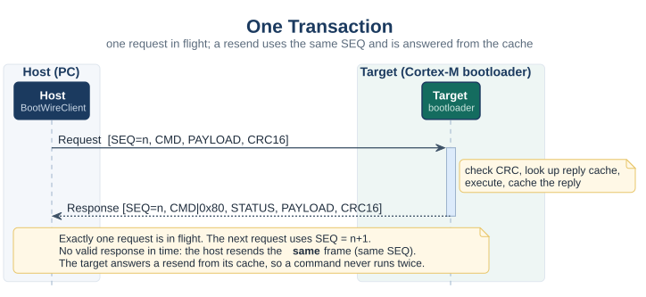

## 2 Architecture

Both sides have the same four layers. Each layer talks only to the layer below it and to its peer.

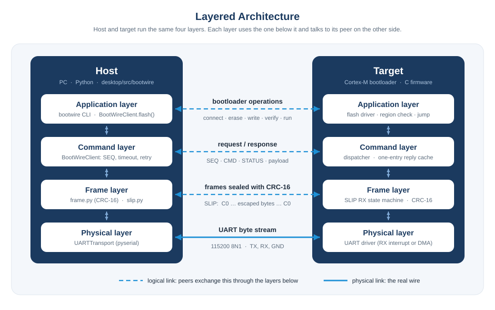

| Layer | Host (`desktop/src/bootwire`) | Target (firmware) |
|---|---|---|
| Application | `bootwire` CLI, `BootWireClient.flash()` | bootloader core: flash driver, region checks, image check, jump |
| Command | `BootWireClient.transact()`: SEQ, timeout, retry, status | dispatcher and one-entry reply cache |
| Frame | `frame.py` (CRC-16), `slip.py` (SLIP, `SlipReader`) | SLIP RX state machine, CRC-16 |
| Physical | `UARTTransport` (pyserial) | UART driver |

What each layer adds to one WRITE on its way down the host stack (the target runs the same steps
upward):

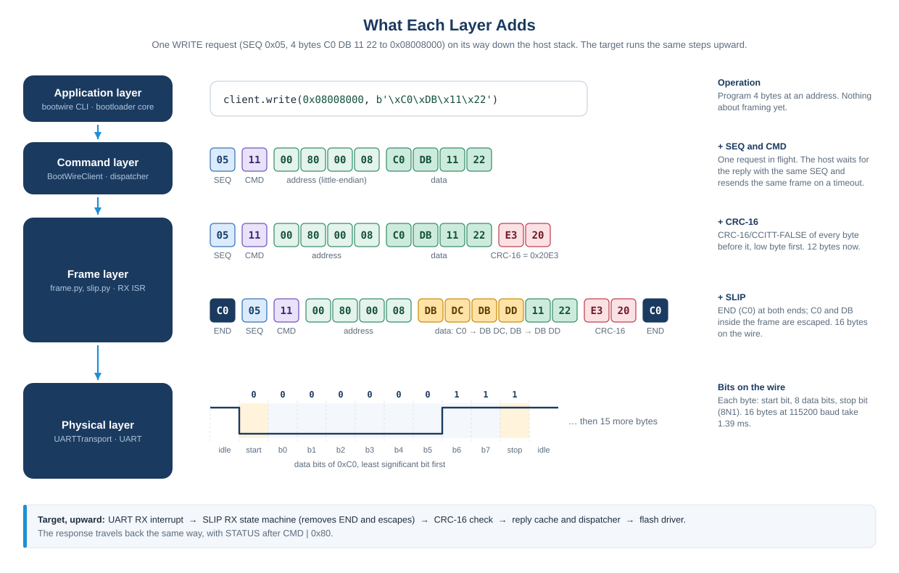

The host never hard-codes the target's flash layout. It reads it from the CONNECT response.

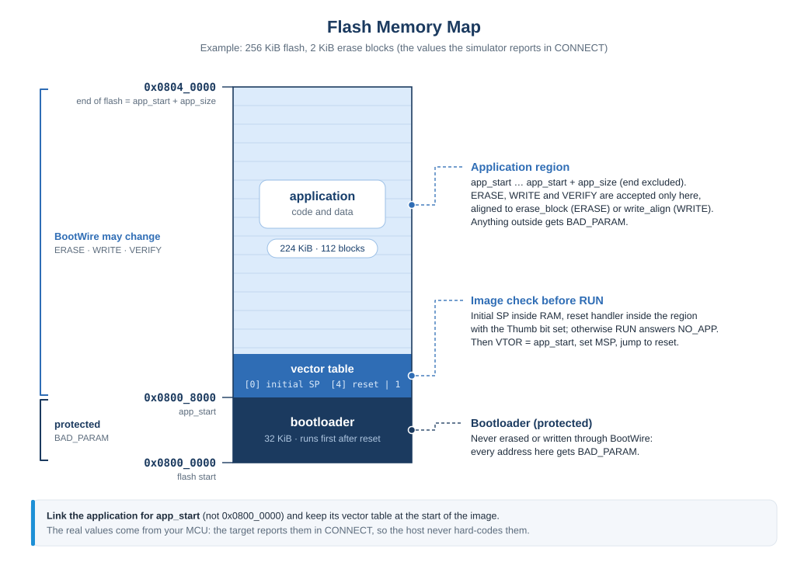

## 3 Physical layer

| Parameter | Value |
|---|---|
| Interface | UART, 3 wires: TX, RX, GND (USB-serial adapter or the board's virtual COM port) |
| Format | 8 data bits, no parity, 1 stop bit |
| Baud rate | 115200 by default; any rate both sides agree on |
| Flow control | none |

Flow control is not needed: the host never has more than one frame in flight, and the largest frame
is a few hundred bytes. XON/XOFF **must not** be used, because 0x11 and 0x13 are normal data bytes.

## 4 Frame layer

### 4.1 Request frame

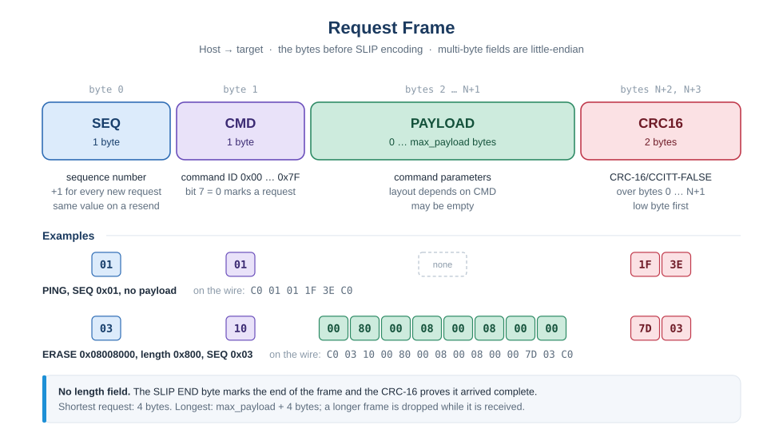

| Offset | Field | Size | Description |
|---|---|---|---|
| 0 | SEQ | 1 | Sequence number chosen by the host |
| 1 | CMD | 1 | Command ID, `0x00`–`0x7F` (bit 7 = 0) |
| 2 | PAYLOAD | N | Command parameters, 0 … `max_payload` bytes |
| 2+N | CRC16 | 2 | CRC-16 of bytes 0 … N+1, little-endian |

### 4.2 Response frame

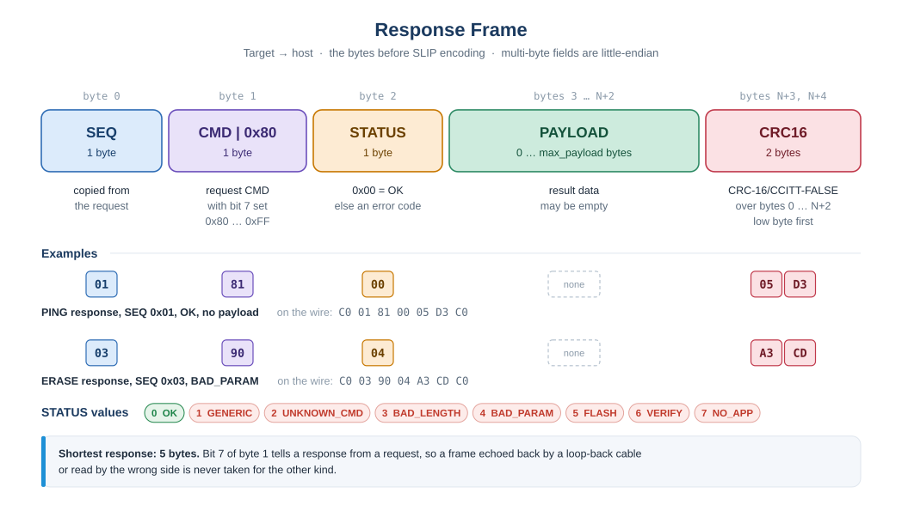

| Offset | Field | Size | Description |
|---|---|---|---|
| 0 | SEQ | 1 | Copied from the request |
| 1 | CMD \| 0x80 | 1 | Request CMD with bit 7 set |
| 2 | STATUS | 1 | `0x00` OK, else an error ([§7](#7-status-codes)) |
| 3 | PAYLOAD | N | Result data, 0 … `max_payload` bytes |
| 3+N | CRC16 | 2 | CRC-16 of bytes 0 … N+2, little-endian |

### 4.3 Encoding rules

- All multi-byte fields, in frames and payloads, are **little-endian** (native for Cortex-M).
- **CRC-16/CCITT-FALSE**: polynomial `0x1021`, initial value `0xFFFF`, no reflection, no final XOR.
  Check value: CRC of ASCII `123456789` = `0x29B1`. It is always present; there is no way to turn it off.
- There is **no length field**. The SLIP END byte ends the frame and the CRC proves it is complete.
- A request shorter than 4 bytes or a response shorter than 5 bytes is invalid.
- A frame longer than `max_payload` + 4 (request) is invalid; the target drops it while receiving.

### 4.4 SLIP framing

Every frame is sent as `END`, the escaped frame, `END`. The CRC is computed on the frame before
escaping and checked after un-escaping.

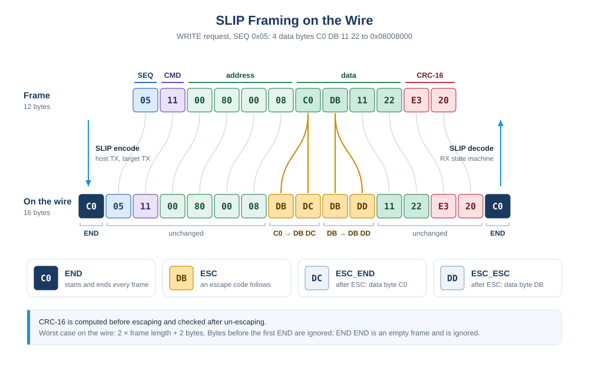

| Name | Value | Meaning |
|---|---|---|
| END | `0xC0` | starts and ends every frame |
| ESC | `0xDB` | the next byte is an escape code |
| ESC_END | `0xDC` | `DB DC` stands for a data byte `0xC0` |
| ESC_ESC | `0xDD` | `DB DD` stands for a data byte `0xDB` |

Receivers run this state machine on every byte. The target runs it in the UART RX interrupt; the host
runs the same logic in `SlipReader`.

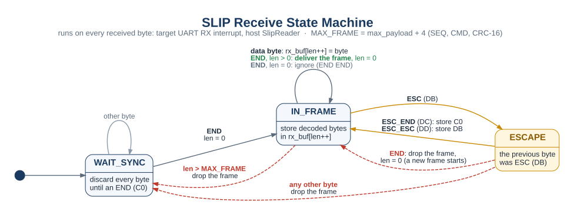

- Bytes before the first END are ignored (start-up noise, log text).
- An empty frame (END END) is ignored.
- ESC followed by anything other than ESC_END or ESC_ESC drops the frame.
- A frame that grows past the buffer is dropped; reception restarts at the next END.

## 5 Transaction rules

These rules make BootWire safe against lost, damaged, repeated and late frames.

1. **One request at a time.** The host **must not** send a new request before it has the response to
   the previous one, or has given up on it.
2. **SEQ.** The host picks a random SEQ for the first request of a session and adds 1 (mod 256) for
   each new request. A **resend uses the same frame**, so the same SEQ.
3. **Matching.** The host accepts a response only if its CRC is correct, bit 7 of CMD is set, and
   SEQ and CMD equal those of the request it is waiting for. Anything else is ignored.
4. **Silence on bad frames.** The target **must not** answer a frame with a wrong CRC, a wrong
   length, a bad escape, or bit 7 of CMD set. It sends nothing; the host times out and resends.
   An error response is impossible here because even SEQ may be the damaged byte.
5. **Reply cache.** The target keeps the last response it sent and the key (SEQ, CMD) of the request
   it answered. If a request arrives with the same key, it **must** send the cached response again
   and **must not** execute the command again. One entry is enough because of rule 1.
6. **CONNECT starts a session.** CONNECT is always executed, even when its key matches the cache,
   and it replaces the cache. Every host session **must** start with CONNECT, so a new host process
   can never receive a cached response from an old session.
7. **Errors are final.** A response with STATUS ≠ OK is returned to the caller at once. The host
   **must not** retry it: the target would give the same answer.
8. **Retry limit.** With no valid response before the timeout, the host resends, up to
   `max_retries` times (default 3), then reports a timeout.

| Situation | Target | Host |
|---|---|---|
| request lost | nothing received | timeout → resend same frame |
| request damaged | CRC fails → silent | timeout → resend same frame |
| response lost | already executed, response cached | timeout → resend → cached response |
| response damaged | — | CRC fails → ignore → timeout → resend → cached response |
| late response to an older request | — | SEQ or CMD differ → ignore |
| bad parameters | error STATUS | report error, no retry |
| target absent | — | timeout after 1 + `max_retries` attempts |

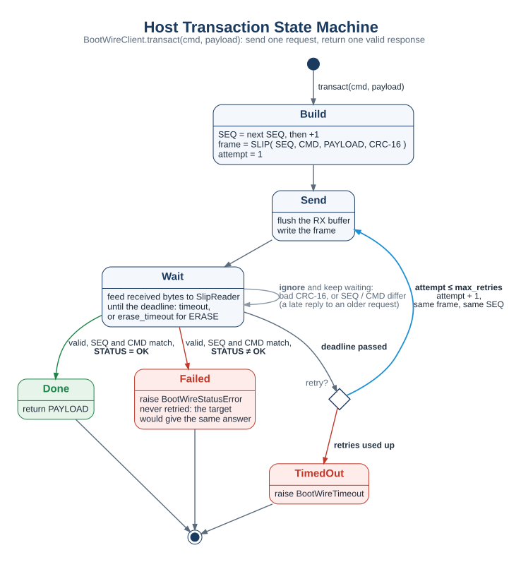

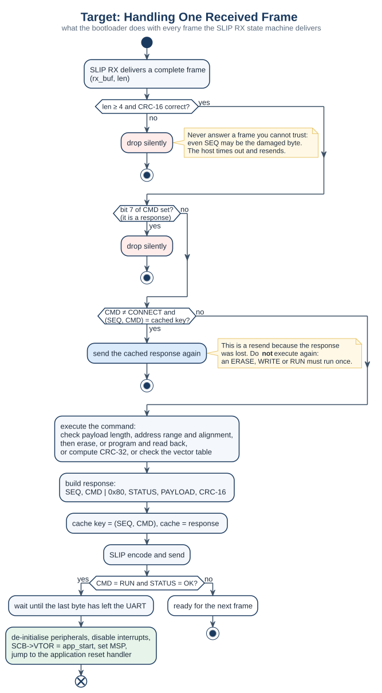

## 6 Commands

| ID | Name | Request payload | Response payload | Errors |
|---|---|---|---|---|
| `0x00` | CONNECT | protocol version (u8) | device info, 23 bytes | BAD_LENGTH |
| `0x01` | PING | any bytes | the same bytes | — |
| `0x10` | ERASE | address (u32), length (u32) | — | BAD_LENGTH, BAD_PARAM, FLASH |
| `0x11` | WRITE | address (u32), data | — | BAD_LENGTH, BAD_PARAM, FLASH, VERIFY |
| `0x12` | VERIFY | address (u32), length (u32), CRC-32 (u32) | CRC-32 computed by the target (u32) | BAD_LENGTH, BAD_PARAM, VERIFY |
| `0x13` | RUN | — | — | BAD_LENGTH, NO_APP |
| `0x40`–`0x7F` | user commands | defined by the user | defined by the user | UNKNOWN_CMD if not implemented |

Every other ID in `0x00`–`0x3F` is reserved for future BootWire commands and answered with UNKNOWN_CMD.

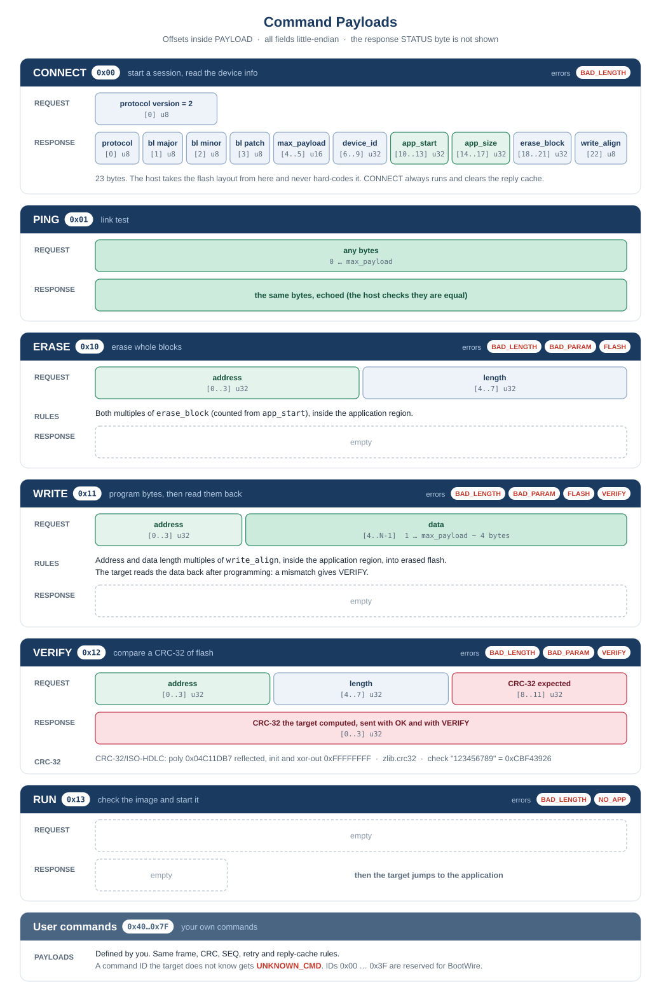

### 6.1 CONNECT `0x00`

Starts a session and reports what the target can do. The target clears its reply cache by storing
this response in it.

| Request offset | Field | Type |
|---|---|---|
| 0 | protocol version of the host (`2`) | u8 |

| Response offset | Field | Type | Meaning |
|---|---|---|---|
| 0 | protocol version | u8 | `2`; the host stops if it differs |
| 1 | bootloader version major | u8 | |
| 2 | bootloader version minor | u8 | |
| 3 | bootloader version patch | u8 | |
| 4 | max_payload | u16 | largest PAYLOAD the target accepts or sends, in bytes |
| 6 | device ID | u32 | for example `DBGMCU->IDCODE` or a product ID |
| 10 | app_start | u32 | first address of the application region |
| 14 | app_size | u32 | size of the application region in bytes |
| 18 | erase_block | u32 | ERASE address and length must be multiples of this (counted from app_start) |
| 22 | write_align | u8 | WRITE address and length must be multiples of this |

The target answers CONNECT even if the host's version differs, so the host can print a clear message.

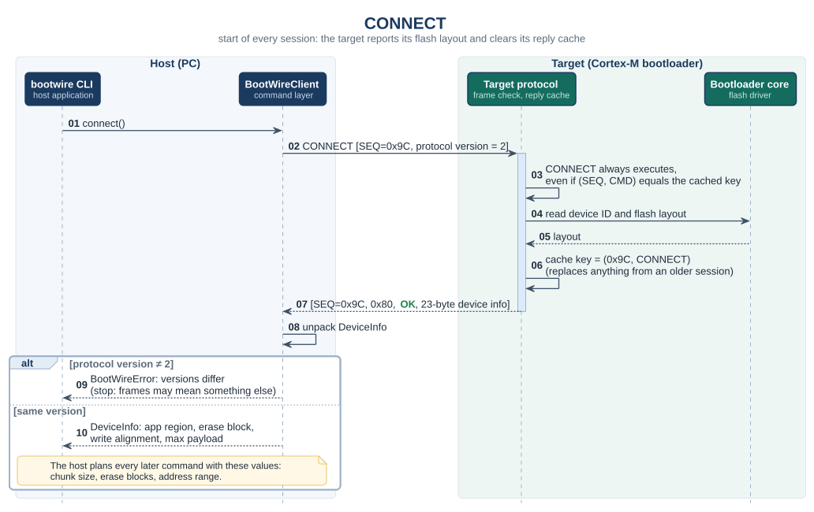

### 6.2 PING `0x01`

Echoes the payload unchanged. Used to test the link and measure round-trip time.

### 6.3 ERASE `0x10`

Erases `[address, address + length)`. Both values must be multiples of `erase_block` and the range
must lie inside the application region. The host sends one ERASE per erase block so every response
arrives quickly.

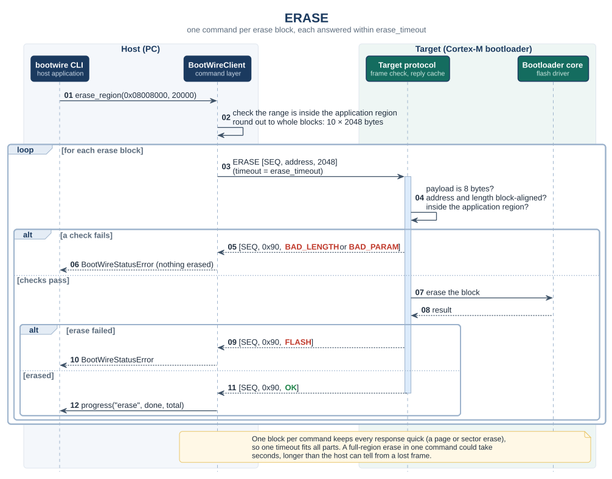

### 6.4 WRITE `0x11`

Programs `data` at `address`. The address and the data length must be multiples of `write_align` and
the range must lie inside the application region. After programming, the target **must** read the
range back and answer VERIFY if it differs (for example because the flash was not erased).
The largest data block is `max_payload − 4`. Each WRITE carries its own address, so the target keeps
no transfer state between commands.

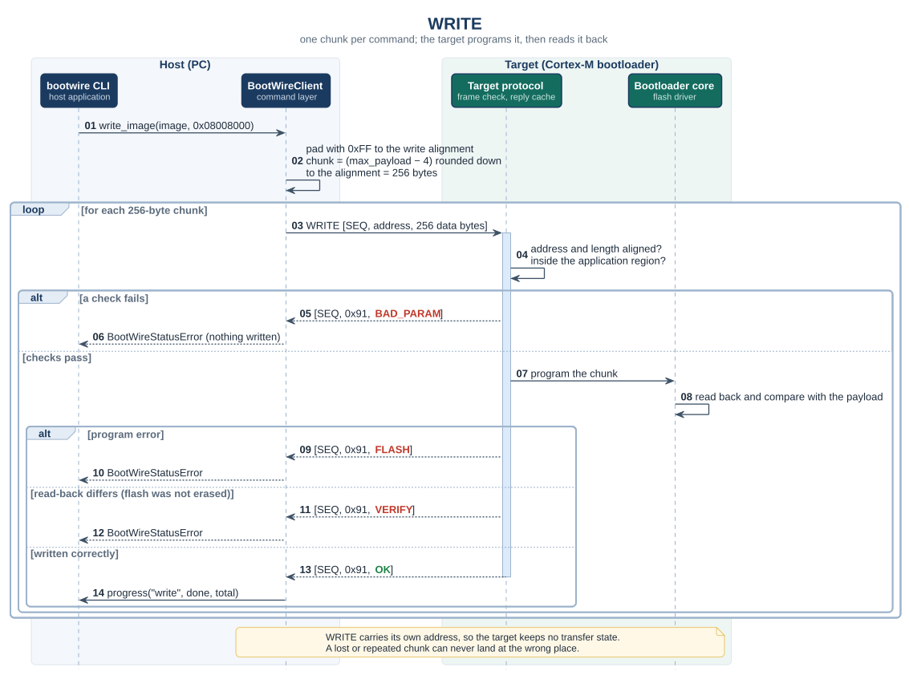

### 6.5 VERIFY `0x12`

The target computes the CRC-32 of `[address, address + length)` and compares it with the CRC-32 in
the request. It answers OK or VERIFY, and in both cases returns the CRC-32 it computed.
CRC-32 is **CRC-32/ISO-HDLC** (the zlib / Ethernet CRC): polynomial `0x04C11DB7` reflected, initial
value `0xFFFFFFFF`, final XOR `0xFFFFFFFF`. Check value: CRC of `123456789` = `0xCBF43926`.

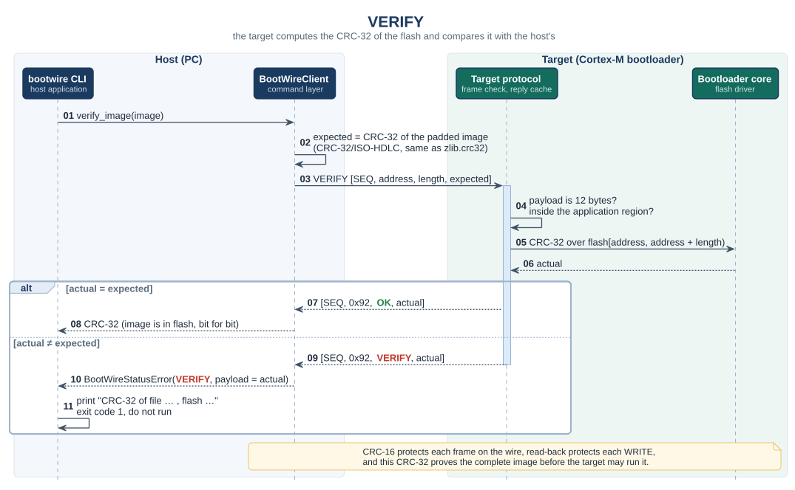

### 6.6 RUN `0x13`

The target checks the application's vector table at `app_start`:

- the initial stack pointer (word 0) is inside RAM and 4-byte aligned, and
- the reset vector (word 1) has bit 0 set (Thumb) and points inside the application region.

If the check fails it answers NO_APP and stays in the bootloader. If it passes it answers OK, waits
until the response has left the UART, and starts the application ([§10.4](#104-jumping-to-the-application)).
A lost RUN response cannot be recovered (the application owns the UART), so the host reports
"not confirmed" rather than an error when RUN times out.

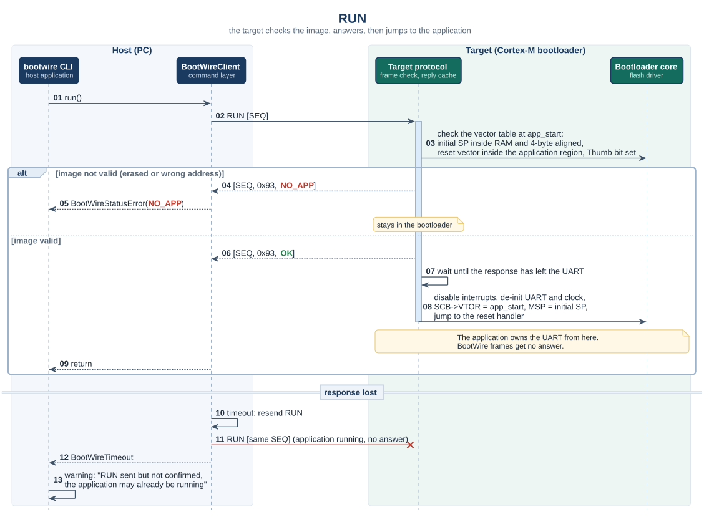

### 6.7 User commands `0x40`–`0x7F`

Free for application-specific commands (configuration, diagnostics, reading a serial number…). They
use the same frames and obey the same transaction rules, including the reply cache: design them so
that they are safe to answer from the cache.

## 7 Status codes

| Value | Name | Meaning |
|---|---|---|
| `0x00` | OK | success |
| `0x01` | GENERIC | failure without a more specific code |
| `0x02` | UNKNOWN_CMD | command ID not supported |
| `0x03` | BAD_LENGTH | payload length wrong for this command |
| `0x04` | BAD_PARAM | address or length outside the application region, or not aligned |
| `0x05` | FLASH | the flash controller reported an erase or program error |
| `0x06` | VERIFY | read-back after WRITE differs, or VERIFY CRC-32 differs |
| `0x07` | NO_APP | RUN refused: no valid application image |

## 8 Flash update procedure

`bootwire flash app.bin` and `BootWireClient.flash()` do exactly this:

1. **CONNECT**; check the protocol version; read the layout.
2. Pad the image with `0xFF` up to `write_align`; check it fits the application region.
3. **ERASE** every erase block the image touches, one command per block.
4. **WRITE** the image in chunks of `max_payload − 4` bytes rounded down to `write_align`.
5. **VERIFY** the whole padded image with one CRC-32.
6. **RUN**, unless asked not to.

Any error status stops the procedure. RUN is never sent for an image that did not pass VERIFY.

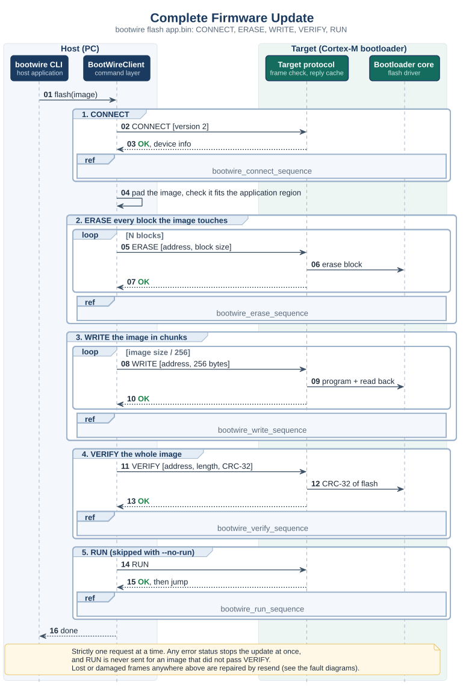

## 9 Fault handling

Each fault in [§5](#5-transaction-rules) has its own diagram.

| Fault | Diagram |
|---|---|
| request lost | 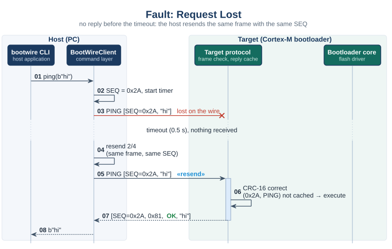 |
| request damaged | 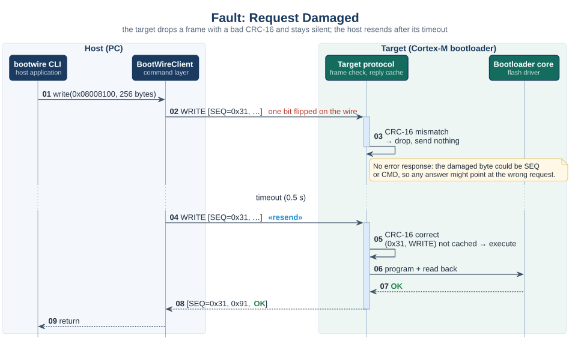 |
| response lost: answered from the cache | 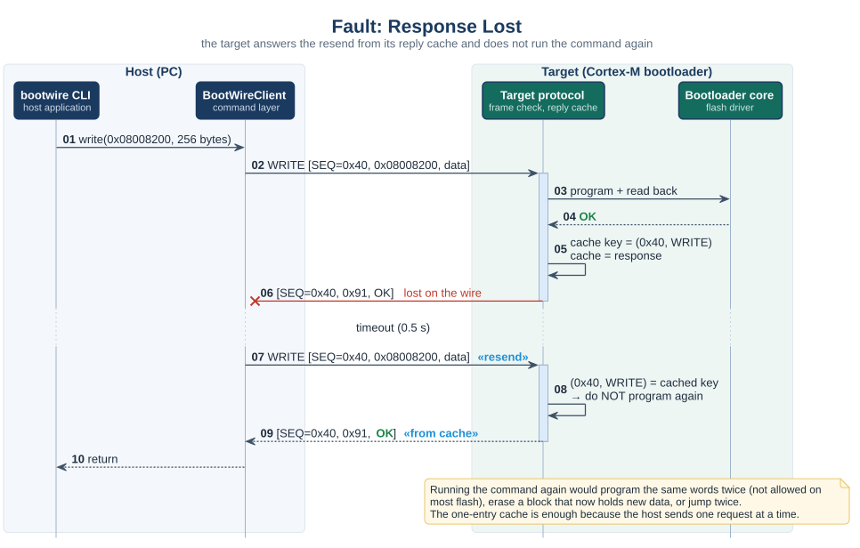 |
| response damaged | 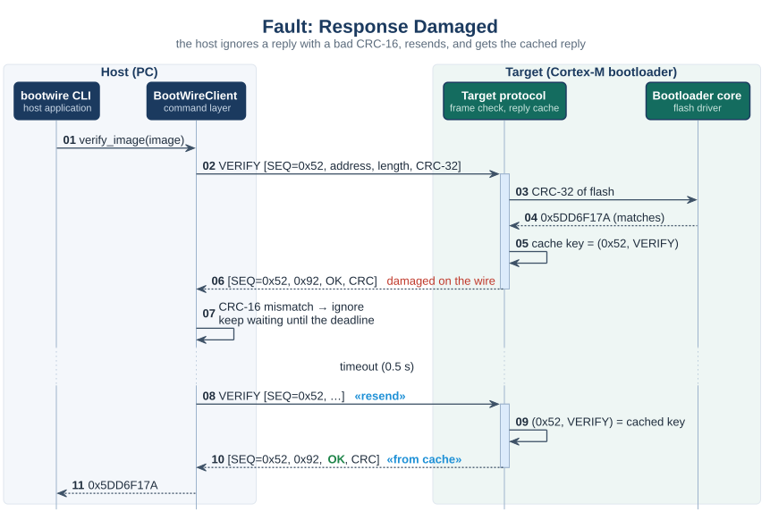 |
| late response to an older request | 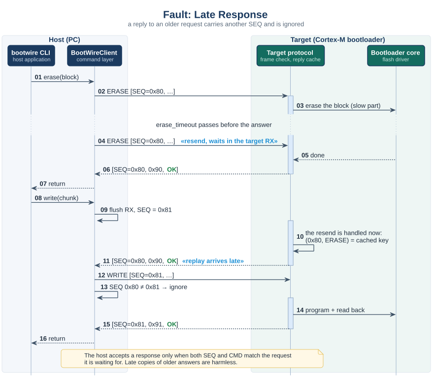 |
| new host session: why CONNECT comes first | 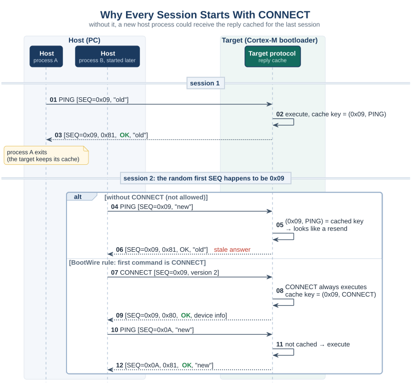 |
| error status: no retry | 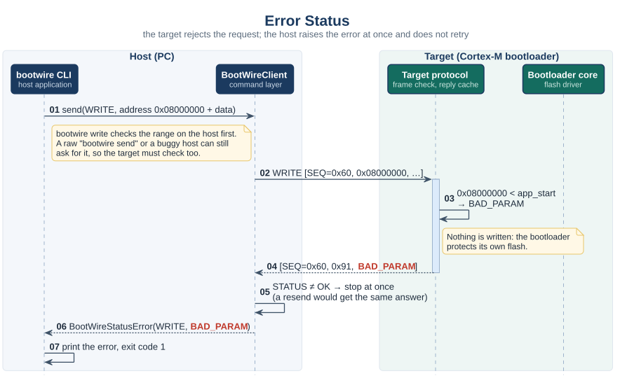 |
| no answer after all retries | 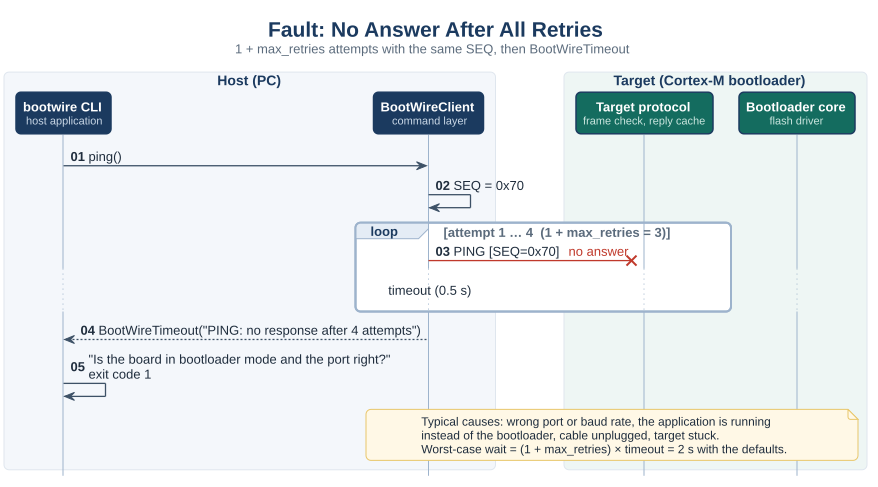 |

## 10 Target behaviour

### 10.1 Start-up

The bootloader runs first after every reset and decides whether to stay.

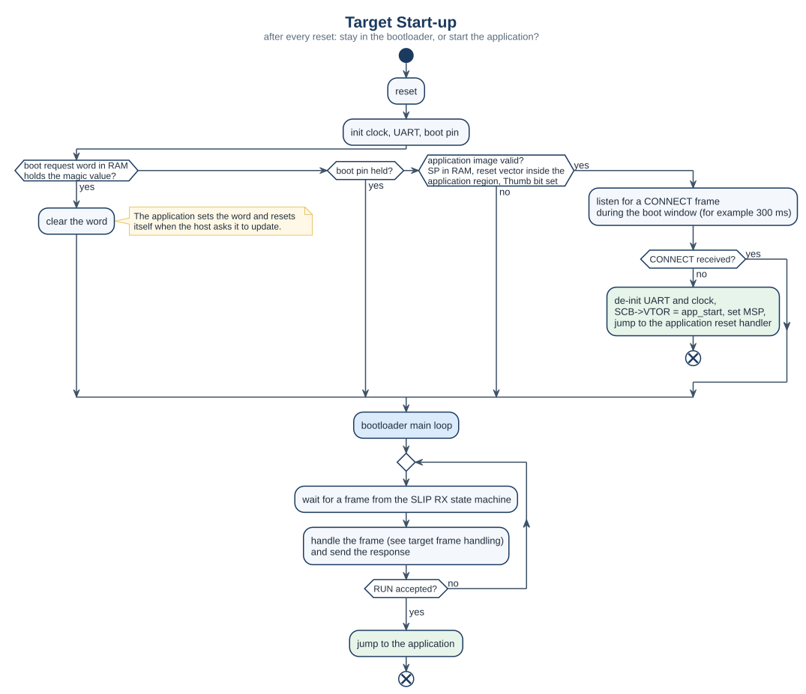

It **should** stay in the bootloader when any of these is true:

- a boot-request word in a RAM area that survives reset holds a magic value (set by the application
  before it resets itself when asked to update);
- a boot pin or button is held;
- the application image fails the vector-table check of [§6.6](#66-run-0x13).

Otherwise it **should** wait a short boot window (for example 300 ms) for a CONNECT and start the
application if none arrives.

### 10.2 Receiving

- Run the SLIP state machine of [§4.4](#44-slip-framing) in the UART RX interrupt (or on a DMA ring
  buffer). Remove escapes while receiving, so the buffer only needs `max_payload + 4` bytes.
- When a frame is complete, hand it to the main loop and stop filling the buffer until the main loop
  has answered. A resend that arrives meanwhile may be lost; the host will resend again.
- Use static buffers only. No `malloc`.

### 10.3 Executing

For every frame, in this order ([target frame handling](image/states/bootwire_target_frame_handling.svg)):

1. length ≥ 4 and CRC-16 correct, else drop silently;
2. bit 7 of CMD clear, else drop silently;
3. CMD ≠ CONNECT and (SEQ, CMD) equal to the cached key → send the cached response, stop;
4. check the payload length, then the address range and alignment;
5. execute; build the response; store it and its key in the cache; send it.

The region check is the bootloader's protection of itself: an address outside
`[app_start, app_start + app_size)` **must** get BAD_PARAM, whatever the host sends.

### 10.4 Jumping to the application

After the RUN response has been sent completely:

1. disable interrupts and the SysTick, de-initialise the UART and other peripherals the bootloader used;
2. clear pending interrupts;
3. set `SCB->VTOR = app_start`;
4. load the main stack pointer with word 0 of the vector table (`__set_MSP`);
5. branch to word 1 (the reset handler).

## 11 Timing

| Setting | Default | Where |
|---|---|---|
| response timeout | 0.5 s | `general.timeout` in `bootwire.yaml`, `--timeout` |
| ERASE response timeout | 5 s (one erase block) | `general.erase_timeout` |
| resends after the first attempt | 3 | `general.max_retries`, `--retries` |
| boot window (target) | about 300 ms | firmware constant |

The target **must** answer every command within the host timeout. Size `max_payload` so that
programming and reading back one WRITE stays well inside 0.5 s; one erase block must finish inside
`erase_timeout` (some Cortex-M parts take more than a second for a 128 KiB sector: raise it there).

## 12 Reference values and test vectors

The target must produce and accept exactly these bytes. They are also checked by
`desktop/tests/test_frame.py`.

| Frame | Bytes (hex) |
|---|---|
| PING request, SEQ 0x01 | `01 01 1F 3E` |
| PING response, SEQ 0x01, OK | `01 81 00 05 D3` |
| CONNECT request, SEQ 0x00, version 2 | `00 00 02 DE EC` |
| ERASE request, SEQ 0x03, 0x08008000, 0x800 | `03 10 00 80 00 08 00 08 00 00 7D 03` |
| ERASE response, SEQ 0x03, BAD_PARAM | `03 90 04 A3 CD` |
| WRITE request, SEQ 0x05, 0x08008000, data `C0 DB 11 22` | `05 11 00 80 00 08 C0 DB 11 22 E3 20` |
| the same WRITE on the wire (SLIP) | `C0 05 11 00 80 00 08 DB DC DB DD 11 22 E3 20 C0` |

| Check value | Result |
|---|---|
| CRC-16/CCITT-FALSE of `123456789` | `0x29B1` |
| CRC-32/ISO-HDLC of `123456789` | `0xCBF43926` |

## 13 Diagram index

Every diagram is generated from a source file; run `./render.sh` to regenerate `image/`:

| Source | Draws | Tool |
|---|---|---|
| `py/bootwire_figures.py` | layered architecture, what each layer adds, memory map, frames, SLIP, payloads | Python 3, no packages |
| `dot/architecture/`, `dot/states/` | host modules, host transaction and SLIP receive state machines | Graphviz |
| `puml/architecture/`, `puml/states/`, `puml/sequences/` | one transaction, flowcharts, every sequence diagram | PlantUML (Java) |
| `py/svg_post.py` | white background, font fallbacks and px sizes for every SVG | Python 3 |

All of them use one palette: navy for the host, teal for the target, green for OK, red for errors
and lost frames, blue for resends and cached replies.

| Group | Diagrams |
|---|---|
| Architecture | [layered architecture](image/architecture/bootwire_layered_architecture.svg), [what each layer adds](image/architecture/bootwire_layer_encapsulation.svg), [one transaction](image/architecture/bootwire_transaction_flow.svg), [flash memory map](image/architecture/bootwire_memory_map.svg), [host software modules](image/architecture/bootwire_host_modules.svg) |
| Frames | [request](image/frames/bootwire_request_frame.svg), [response](image/frames/bootwire_response_frame.svg), [frame to wire](image/frames/bootwire_wire_format.svg), [command payloads](image/frames/bootwire_command_payloads.svg) |
| State machines | [host transaction](image/states/bootwire_host_transaction_state.svg), [SLIP receive](image/states/bootwire_slip_rx_state.svg), [target frame handling](image/states/bootwire_target_frame_handling.svg), [boot entry](image/states/bootwire_boot_entry.svg) |
| Commands | [layered WRITE](image/sequences/bootwire_layered_sequence.svg), [CONNECT](image/sequences/bootwire_connect_sequence.svg), [ERASE](image/sequences/bootwire_erase_sequence.svg), [WRITE](image/sequences/bootwire_write_sequence.svg), [VERIFY](image/sequences/bootwire_verify_sequence.svg), [RUN](image/sequences/bootwire_run_sequence.svg), [complete update](image/sequences/bootwire_flash_update_sequence.svg) |
| Faults | [request lost](image/sequences/bootwire_request_lost_sequence.svg), [request damaged](image/sequences/bootwire_corrupted_request_sequence.svg), [response lost](image/sequences/bootwire_response_lost_sequence.svg), [response damaged](image/sequences/bootwire_corrupted_response_sequence.svg), [late response](image/sequences/bootwire_stale_response_sequence.svg), [new session](image/sequences/bootwire_new_session_sequence.svg), [error status](image/sequences/bootwire_error_status_sequence.svg), [retries used up](image/sequences/bootwire_retries_exhausted_sequence.svg) |

## 14 Revision history

| Date | Version | Changes |
|---|---|---|
| 2025-06-30 | 0.1 | First draft: CRA (command, response, ACK) with session IDs, priorities, optional CRC |
| 2026-11-11 | 0.2 | Redesigned for a bootloader: request/response with stop-and-wait and a reply cache; ACK frame, priorities, length fields and optional CRC removed; CRC-16 always on; CONNECT, PING, VERIFY with CRC-32, addressed WRITE; status codes and timing defined; all diagrams redrawn on a white background with one palette, new "what each layer adds" figure |
